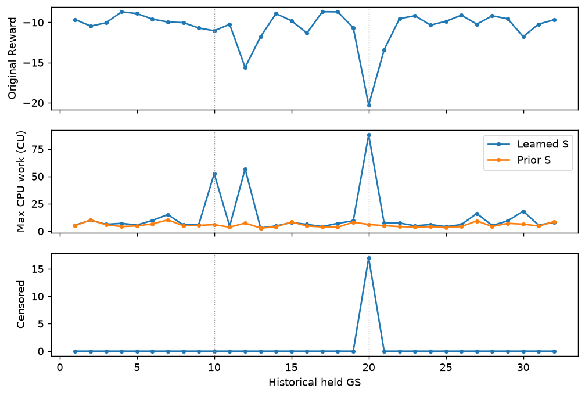
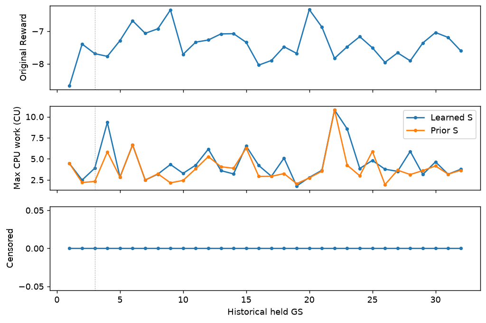

# EXP079 Agent-S 价值学习与联合可靠性

源码基线 `2263cdfaf1747e0f25c689b482c9f22a12e86634`。协议见 [PROTOCOL.md](PROTOCOL.md)。原始矩阵、梯度、逐节点物理账本和调度诊断保存于 `runs/results/EXP079/`。

结束训练臂 0/9，独立条件 0/36。

烟测 A/B/C 的真实 S 优化为 64/0/128。C 断点续训的权重、目标、Replay 和优化器与连续运行一致。新压力烟测的五臂消费同流，并核对同布局。按 EXP078 原训练流重跑 A 的前 8 GS，矩阵、时延、Reward、S 更新和守恒账本一致。

## P0 归档物理诊断

全 32 槽重放与 EXP078 逐槽核对。下列调度续策共享真实开口、请求和 D 矩阵。单动作分叉之后继续用同一冻结学习 S。

| 场景/GS | 两槽实际分歧/动作数 | 学习 S/先验 R | 学习 S/先验 E2E | 学习 S/先验 CPU 峰值 | 学习 S/先验截尾 |
|---|---:|---:|---:|---:|---:|
| pressure/10 | 1324/5042 | -10.641/-8.935 | 1.0371/0.8660 | 52.42/7.71 | 0/0 |
| pressure/20 | 1381/5232 | -16.835/-9.369 | 1.4874/0.9091 | 87.96/6.89 | 17/0 |
| regional/3 | 500/2814 | -7.728/-7.394 | 0.7441/0.7109 | 9.33/5.83 | 0/0 |

| 场景/GS/阶段 | 学习节点→先验 | 先验差/残差优势 | 实际开口 CPU CU | 本阶段用时 学习/先验 | 更换节省本人/其他时延 | 换先验的 ΔR |
|---|---|---:|---:|---:|---:|---:|
| pressure/10/15 | 9→22 | 0.0664/0.1064 | 4.29/0.00 | —/— | -0.0616/+0.4950 | -2.4556 |
| pressure/10/15 | 9→10 | 1.2996/1.7416 | 52.01/0.00 | —/— | +2.2619/-5.0274 | -0.0286 |
| pressure/20/3 | 15→8 | 0.3857/0.4544 | 11.09/0.00 | —/— | +0.0161/+0.7791 | +1.5001 |
| pressure/20/3 | 15→12 | 1.7396/1.8366 | 82.26/0.00 | —/— | +3.0097/+1.7369 | +0.0646 |
| regional/3/3 | 15→14 | 0.0850/0.0903 | 2.07/0.00 | —/— | -0.1138/-0.0780 | -0.0144 |
| regional/3/26 | 9→12 | 0.1484/0.1486 | 3.82/0.00 | —/— | +0.0219/-0.1520 | +0.0258 |


Seed14 Replay 25000 条，动作节点预测 CPU 排队 ≥500 ms 为 51 条，≥1 s 为 0 条，同时明显背离先验与 ≥500 ms 为 9 条。恢复期和阶段/节点/链路劳务账本逐槽保留。S 原信用近似单请求阶段用时，无法直接计入本决策对其他活动请求的等待外部性。同分叉的本人和同时在途请求改善量可见这种方向分离。


## 随机起点和在线训练

A 原 D/S，B 学 D 配先验 S，C 学 D 及优势单位校准 S。C 保留合法节点平均残差，优势部分乘 0.25。训练行为、线上 Q 和目标 Q 使用同一变换。默认 D 与原模拟环境沿用，B 不生成调度 Replay。

| 种子/臂 | GS | D 更新 / S 更新 | D/S 决策 | 在线 R/E2E/P99 | 最差 R | 严重/截尾/末端 | D 梯度裁剪 | S 梯度 / 损失均值 |
|---|---:|---:|---:|---:|---:|---:|---:|---:|

| 种子/臂 | GS | 固定 R/E2E/P99 | 严重/截尾/未完成 |
|---|---:|---:|---:|

## 独立消融和判定

完整独立评价 0/36 组。调度两臂逐槽使用同一布局。随机初始 D 也按两小时重解码，因而 D 增量共享部署节奏。

| 种子/臂/场景/因子 | R/E2E/P99 | CPU/链路 | 严重/截尾/末端 | S 偏离先验 | 副本均值 | 新增/移除/持有 |
|---|---:|---:|---:|---:|---:|---:|

## 原始图与复现




```powershell
python -m scripts.exp079_run diagnose
python -m scripts.exp079_run smoke
python -m scripts.exp079_run all
python -m scripts.exp079_run report
```
