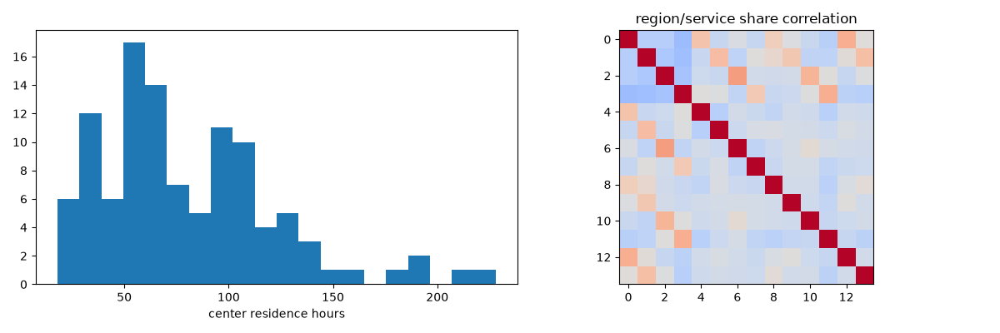
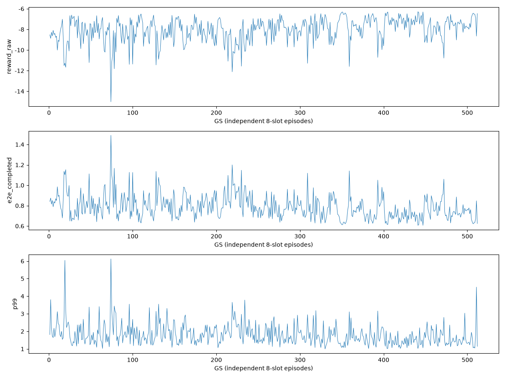
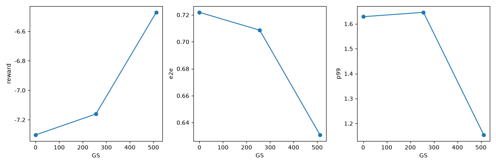
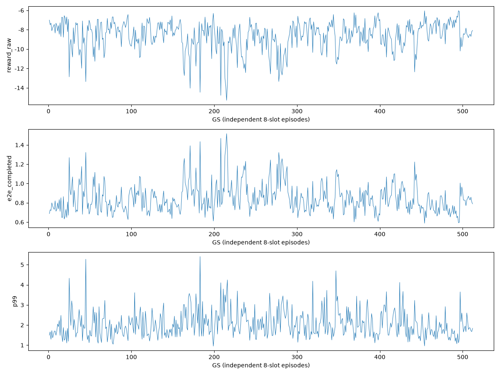
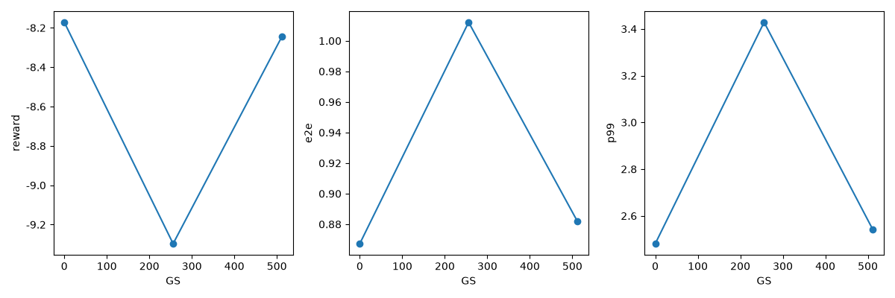
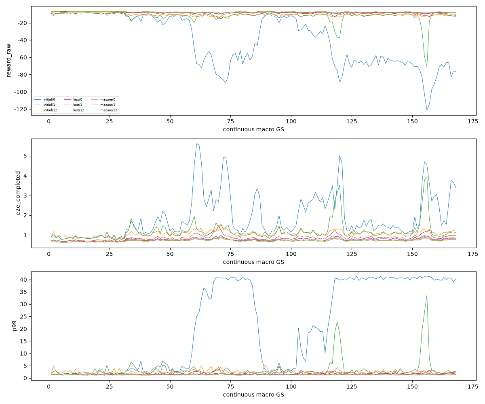
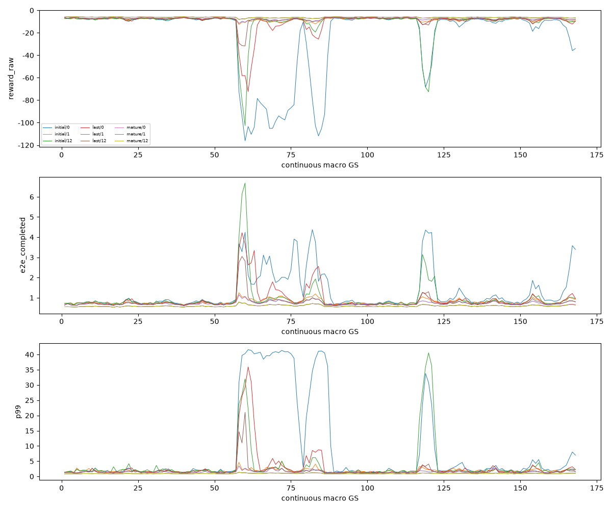

# EXP086 长期需求与部署学习


状态：complete。代码：d0f18d1c9e3697d9fb233609390f7174d221cdb1。

EXP085最终归档6d11a45、UTF-8校正2e23c37：P1通过、策略一致验证三个候选全拒绝；未运行新最终测试。保留48维资产，不晋级权重。

本轮仅环境与阶段一。D随机初始化，冻结同种子EXP081 GS5040 S；无时机学习。

7200秒宏观一步，24秒微观窗口；不是完整两小时队列等价。8GS训练episode相互独立，168GS评价连续继承队列。

配置/运行值：configs/exp086_long_demand.json、runs/results/EXP086/runtime.json；主协议见PROTOCOL.md。

完成任务E2E按任务加权，period_mean另报；P99包含惩罚请求，原始Reward不改、不平滑。


工程烟测曾遇到沙箱拒绝原子替换已存在best.pt；在本地获准写权限下恢复成功。未修改物理规则或训练参数。EXP085归档中文编码已在2e23c37校正。

片段登记曾误用fixed而物理评价使用holdout；在未运行迁移片段物理收益前，按相同需求可见条件校正该片段。稳定与高强度片段经holdout核验仍满足条件，未更换。原登记与理由保留于window_protocol.initial-fixed-split.json。

`smoke/complete.json`：

```json

{
  "status": "passed",
  "old_mode_exact": true,
  "resume_exact": true,
  "d_updates_per_smoke": 2,
  "s_updates": 0,
  "physical_seconds": 5.338995700003579,
  "physical_gs": 6,
  "requests": 3302,
  "events": 45025,
  "seconds": 54.90525090000301
}

```

`demand_audit.json`：

```json

{
  "status": "complete",
  "summaries": [
    {
      "hours": 72,
      "slots": 4096,
      "mean_rate": 21.538616804800622,
      "rate_sd": 7.074450007777998,
      "autocorrelation1": 0.9512400878581383,
      "residence_hours_quantiles": [
        28.6,
        70.0,
        154.39999999999986
      ],
      "distinct_durations": 55,
      "transitions": 107,
      "daily_mean": 1.0000000000000002,
      "cpu_quantiles": [
        0.16385107284980063,
        0.3956526630159277,
        0.6187015530970359,
        0.781789943985968
      ]
    },
    {
      "hours": 48,
      "slots": 2048,
      "mean_rate": 21.67523924867587,
      "rate_sd": 7.1660769359113115,
      "autocorrelation1": 0.942622710349289,
      "residence_hours_quantiles": [
        20.0,
        46.0,
        96.5
      ],
      "distinct_durations": 40,
      "transitions": 86,
      "daily_mean": 1.0000000000000002,
      "cpu_quantiles": [
        0.1602891951435369,
        0.3924651651710317,
        0.6272226488281596,
        0.7844014795210035
      ]
    },
    {
      "hours": 120,
      "slots": 2048,
      "mean_rate": 21.181392606875434,
      "rate_sd": 7.1076906116269605,
      "autocorrelation1": 0.9517597363523612,
      "residence_hours_quantiles": [
        43.0,
        106.0,
        233.5
      ],
      "distinct_durations": 32,
      "transitions": 36,
      "daily_mean": 1.0000000000000002,
      "cpu_quantiles": [
        0.1817540772936222,
        0.37201307009548906,
        0.6266935544171229,
        0.7930904513112088
      ]
    }
  ],
  "seconds": 2.744342499994673
}

```

`status.json`：

```json

{
  "status": "complete",
  "seconds": 1798.2993105999922,
  "source": {
    "commit": "d0f18d1c9e3697d9fb233609390f7174d221cdb1",
    "dirty": true,
    "tracked_dirty": true,
    "python": "3.11.7",
    "os": "Windows-10-10.0.26200-SP0",
    "torch": "2.11.0+cpu",
    "numpy": "2.4.6"
  }
}

```

生效CPU总量 366.918513 CU/s；成本 {'delay_weight': 10.0, 'reference_rate': 20.0, 'holding_weight': 0.08, 'switch_weight': 0.04, 'removal_ratio': 0.25, 'resource_normalizer': 2.0, 'latency_objective': 'period_mean'}；末端尾段 8.0 s，失败惩罚 10.0 s。

生效参数按基础JSON→EXP043 workload profile→EXP081 B训练配方→EXP086新需求依次导出。拓扑/各节点与阶段参数完整见runtime.json。

源码SHA256：

```json

{
  "scripts/exp086_run.py": "be209144ef7cf7baf800e43dd673a4f0ea5e906d26e6590a783619a2a142cd3b",
  "edge_d/long_demand.py": "28e8ecb1b58e1065ab7ff15f469ef7f21208c29862cfa10207ea33a5e6a313e9",
  "edge_joint/adaptive_training.py": "2094af3d6eb981ebd4870a6a63978d0d5ff502a738af3144c4b38bffdb0f5321",
  "edge_joint/adaptive_runner.py": "27292767dd0d632bff50a32b1c91eb688d2ad033e5f40df64d308147d7ee6a22",
  "edge_joint/adaptive_physics.py": "65e2c933fd32b2ab05dd758386161fdee46aa0f1f7f27ea686112d94a0655fb7",
  "edge_d/placement.py": "91ee46ea2cee00e06cc8eb3e862f417eda6a3536c676aa7b8988cb9f4fd8105d",
  "comparison/monolithic_service/environment.py": "f872fcf4e47ef70e8da65da938533802d58699272a45cafac74c760cc57be724",
  "configs/exp086_long_demand.json": "9b52028450b9362da0aa9ef28fe7c1fbc2a96f52f4eb2cc58938670739a69c67"
}

```




需求主配置均值/驻留/相关性为廉价生成序列结果，不是物理性能；跨轨迹随机相位和中心不等于物理队列预热。

窗口检查 stable：

|窗口/周期槽|Reward|加权E2E|P99|截尾|CPU|墙钟s|

|---|---|---|---|---|---|---|

|24.0|-6.531380|0.633732|1.154894|0|4.306|9.73|

|24.1|-6.547640|0.632429|1.165718|0|3.871|9.05|

|48.0|-6.558876|0.635956|1.152014|0|4.109|18.89|

|48.1|-6.597758|0.637482|1.164221|0|3.977|22.09|

|96.0|-6.506837|0.629218|1.132543|0|4.993|42.96|

|96.1|-6.542504|0.630330|1.148145|0|3.777|43.60|

24s同流REDEPLOY−KEEP：ΔReward=-0.016260，ΔE2E=-0.001304s；共同8s年龄诊断={'0': {'mean_observed_delay': 0.6337324481320311, 'incomplete': 0, 'requests': 4409}, '1': {'mean_observed_delay': 0.6324285629877142, 'incomplete': 0, 'requests': 4409}}。

48s同流REDEPLOY−KEEP：ΔReward=-0.038882，ΔE2E=0.001526s；共同8s年龄诊断={'0': {'mean_observed_delay': 0.6359555639942122, 'incomplete': 0, 'requests': 9012}, '1': {'mean_observed_delay': 0.6374819678117456, 'incomplete': 0, 'requests': 9012}}。

96s同流REDEPLOY−KEEP：ΔReward=-0.035667，ΔE2E=0.001112s；共同8s年龄诊断={'0': {'mean_observed_delay': 0.6292179610007149, 'incomplete': 0, 'requests': 17685}, '1': {'mean_observed_delay': 0.6303301591470426, 'incomplete': 0, 'requests': 17685}}。

窗口收益符号 [-1, -1, -1]；所测片段方向一致，不证明7200s等价。

截止为槽末+8s，长窗口早到请求观察机会更多。age8_diagnostic单独记录共同年龄截止，不能把截尾下降直接解释为改善。

窗口检查 migration：

|窗口/周期槽|Reward|加权E2E|P99|截尾|CPU|墙钟s|

|---|---|---|---|---|---|---|

|24.0|-6.312465|0.607861|0.984654|0|4.932|5.26|

|24.1|-6.354655|0.610675|0.970710|0|3.460|5.34|

|48.0|-6.339348|0.610991|1.002009|0|3.565|10.57|

|48.1|-6.365559|0.612076|0.976415|0|3.559|10.35|

|96.0|-6.365327|0.614348|1.001880|0|4.138|21.44|

|96.1|-6.401950|0.616438|0.993767|0|4.138|21.73|

24s同流REDEPLOY−KEEP：ΔReward=-0.042190，ΔE2E=0.002814s；共同8s年龄诊断={'0': {'mean_observed_delay': 0.607860915243002, 'incomplete': 0, 'requests': 3557}, '1': {'mean_observed_delay': 0.6106746853099431, 'incomplete': 0, 'requests': 3557}}。

48s同流REDEPLOY−KEEP：ΔReward=-0.026211，ΔE2E=0.001085s；共同8s年龄诊断={'0': {'mean_observed_delay': 0.6109911311710833, 'incomplete': 0, 'requests': 7057}, '1': {'mean_observed_delay': 0.6120763079608715, 'incomplete': 0, 'requests': 7057}}。

96s同流REDEPLOY−KEEP：ΔReward=-0.036623，ΔE2E=0.002091s；共同8s年龄诊断={'0': {'mean_observed_delay': 0.6143477856640894, 'incomplete': 0, 'requests': 14278}, '1': {'mean_observed_delay': 0.6164384400483679, 'incomplete': 0, 'requests': 14278}}。

窗口收益符号 [-1, -1, -1]；所测片段方向一致，不证明7200s等价。

截止为槽末+8s，长窗口早到请求观察机会更多。age8_diagnostic单独记录共同年龄截止，不能把截尾下降直接解释为改善。

窗口检查 high：

|窗口/周期槽|Reward|加权E2E|P99|截尾|CPU|墙钟s|

|---|---|---|---|---|---|---|

|24.0|-6.971951|0.674237|1.359363|0|6.012|8.07|

|24.1|-6.949192|0.669761|1.308298|0|5.407|8.47|

|48.0|-7.026277|0.679251|1.397116|0|7.205|16.18|

|48.1|-6.994058|0.673877|1.354406|0|5.228|17.06|

|96.0|-7.014517|0.677983|1.379971|0|5.113|33.63|

|96.1|-6.986091|0.673113|1.350822|0|4.586|33.80|

24s同流REDEPLOY−KEEP：ΔReward=0.022758，ΔE2E=-0.004476s；共同8s年龄诊断={'0': {'mean_observed_delay': 0.6742369010611986, 'incomplete': 0, 'requests': 5565}, '1': {'mean_observed_delay': 0.669761249249448, 'incomplete': 0, 'requests': 5565}}。

48s同流REDEPLOY−KEEP：ΔReward=0.032219，ΔE2E=-0.005374s；共同8s年龄诊断={'0': {'mean_observed_delay': 0.6792514916433156, 'incomplete': 0, 'requests': 11236}, '1': {'mean_observed_delay': 0.6738774703942126, 'incomplete': 0, 'requests': 11236}}。

96s同流REDEPLOY−KEEP：ΔReward=0.028426，ΔE2E=-0.004870s；共同8s年龄诊断={'0': {'mean_observed_delay': 0.6779827569623084, 'incomplete': 0, 'requests': 22366}, '1': {'mean_observed_delay': 0.673112650199919, 'incomplete': 0, 'requests': 22366}}。

窗口收益符号 [1, 1, 1]；所测片段方向一致，不证明7200s等价。

截止为槽末+8s，长窗口早到请求观察机会更多。age8_diagnostic单独记录共同年龄截止，不能把截尾下降直接解释为改善。

Seed20261113：

```json

{
  "gs": 512,
  "d_updates": 64,
  "s_updates": 0,
  "s_unchanged": true,
  "d_initial": "5cd8ea5ed5ed79a88781c54f09fbee08e51f77e71e3198e8be96ed87d21c0b19",
  "d_final": "c239d05e581c6570912f33646a3dde16bf2086bbe6ad7bf37742942513954666",
  "seconds": 389.64351049999823,
  "metrics": {
    "reward": -8.053186283223837,
    "e2e": 0.8092312814691079,
    "p95": 1.4568967483269972,
    "p99": 2.142406588548419,
    "e2e_penalized": 0.8092312814691079,
    "completed_p99": 2.142406588548419,
    "worst": -15.015244751873691,
    "worst1": -12.296628691313748,
    "worst5": -11.15166615626366,
    "worst1_n": 6,
    "worst5_n": 26,
    "spikes": 0,
    "backlog": 73,
    "requests": 249098,
    "completed": 249098,
    "censored": 0,
    "post_cutoff": 0,
    "terminal": 0,
    "dropped": 0,
    "cpu": 28.657541037321224,
    "cpu_peak_jobs": 19,
    "wire": 6.705695930846151,
    "wired_peak_jobs": 6,
    "switch": 21.174910312028103,
    "holding": 0.12489514297075555,
    "severe": 0,
    "redeploy": 448,
    "keep": 0,
    "changes": 511,
    "replicas": 87.6328125,
    "independent_episodes": 64,
    "period_mean_e2e": 0.7886933893549901,
    "period_mean_penalized": 0.7886933893549901,
    "events": 3483383,
    "s_decisions": 696937,
    "macro_hours": 1024,
    "micro_seconds": 12288,
    "added": 24535,
    "removed": 18933,
    "holding_total": 63.94631320102689,
    "decode_seconds": 5.429897399939364
  },
  "best_gs": 512,
  "models": {
    "best": "c90354fcbf6212a0780144336aca39cd38295ef917e95f0813decdfc63b61c15",
    "last": "2d6b57a613d534ceebcddb974524bec3177119bd525fc158a3fc680210f3fbcd",
    "resume_latest": "dc79b9e13d111d2aa902b2c5020e556fda323c63f7a8ec11226998c78a6baa59"
  },
  "source": {
    "commit": "d0f18d1c9e3697d9fb233609390f7174d221cdb1",
    "dirty": true,
    "tracked_dirty": true,
    "python": "3.11.7",
    "os": "Windows-10-10.0.26200-SP0",
    "torch": "2.11.0+cpu",
    "numpy": "2.4.6"
  },
  "code_sha256": {
    "scripts/exp086_run.py": "be209144ef7cf7baf800e43dd673a4f0ea5e906d26e6590a783619a2a142cd3b",
    "edge_d/long_demand.py": "28e8ecb1b58e1065ab7ff15f469ef7f21208c29862cfa10207ea33a5e6a313e9",
    "edge_joint/adaptive_training.py": "2094af3d6eb981ebd4870a6a63978d0d5ff502a738af3144c4b38bffdb0f5321",
    "edge_joint/adaptive_runner.py": "27292767dd0d632bff50a32b1c91eb688d2ad033e5f40df64d308147d7ee6a22",
    "edge_joint/adaptive_physics.py": "65e2c933fd32b2ab05dd758386161fdee46aa0f1f7f27ea686112d94a0655fb7",
    "edge_d/placement.py": "91ee46ea2cee00e06cc8eb3e862f417eda6a3536c676aa7b8988cb9f4fd8105d",
    "comparison/monolithic_service/environment.py": "f872fcf4e47ef70e8da65da938533802d58699272a45cafac74c760cc57be724",
    "configs/exp086_long_demand.json": "9b52028450b9362da0aa9ef28fe7c1fbc2a96f52f4eb2cc58938670739a69c67"
  }
}

```



固定验证GS：[0, 256, 512]，详见seed20261113/fixed.jsonl。



固定验证汇总：

```json

[
  [
    0,
    {
      "reward": -7.3029403341237815,
      "e2e": 0.7218965462780736,
      "p95": 1.1966776724704506,
      "p99": 1.6286045447146638,
      "e2e_penalized": 0.7218965462780736,
      "completed_p99": 1.6286045447146638,
      "worst": -7.917334451809266,
      "worst1": -7.917334451809266,
      "worst5": -7.917334451809266,
      "worst1_n": 1,
      "worst5_n": 1,
      "spikes": 0,
      "backlog": 19,
      "requests": 4859,
      "completed": 4859,
      "censored": 0,
      "post_cutoff": 0,
      "terminal": 0,
      "dropped": 0,
      "cpu": 8.079341686799749,
      "cpu_peak_jobs": 7,
      "wire": 2.6892465912339705,
      "wired_peak_jobs": 4,
      "switch": 0.12142100002819957,
      "holding": 0.0847038835041012,
      "severe": 0,
      "redeploy": 14,
      "keep": 0,
      "changes": 14,
      "replicas": 58.1875,
      "independent_episodes": 2,
      "period_mean_e2e": 0.7210647638117917,
      "period_mean_penalized": 0.7210647638117917,
      "events": 62044,
      "s_decisions": 13730,
      "macro_hours": 32,
      "micro_seconds": 384,
      "added": 155,
      "removed": 39,
      "holding_total": 1.355262136065619,
      "decode_seconds": 0
    }
  ],
  [
    256,
    {
      "reward": -7.160788548025581,
      "e2e": 0.7086390880991441,
      "p95": 1.1994229542732637,
      "p99": 1.6461816678276977,
      "e2e_penalized": 0.7086390880991441,
      "completed_p99": 1.6461816678276977,
      "worst": -8.63417983490076,
      "worst1": -8.63417983490076,
      "worst5": -8.63417983490076,
      "worst1_n": 1,
      "worst5_n": 1,
      "spikes": 0,
      "backlog": 21,
      "requests": 4859,
      "completed": 4859,
      "censored": 0,
      "post_cutoff": 0,
      "terminal": 0,
      "dropped": 0,
      "cpu": 11.077315854250354,
      "cpu_peak_jobs": 8,
      "wire": 2.6864345735115625,
      "wired_peak_jobs": 5,
      "switch": 0.14260934318133012,
      "holding": 0.0880748774865017,
      "severe": 0,
      "redeploy": 14,
      "keep": 0,
      "changes": 14,
      "replicas": 61.0,
      "independent_episodes": 2,
      "period_mean_e2e": 0.7063800586590245,
      "period_mean_penalized": 0.7063800586590245,
      "events": 63011,
      "s_decisions": 13730,
      "macro_hours": 32,
      "micro_seconds": 384,
      "added": 178,
      "removed": 57,
      "holding_total": 1.409198039784027,
      "decode_seconds": 0
    }
  ],
  [
    512,
    {
      "reward": -6.4712464733282085,
      "e2e": 0.6308124974065685,
      "p95": 0.9768982473045738,
      "p99": 1.1539364305886146,
      "e2e_penalized": 0.6308124974065685,
      "completed_p99": 1.1539364305886146,
      "worst": -7.363385757385805,
      "worst1": -7.363385757385805,
      "worst5": -7.363385757385805,
      "worst1_n": 1,
      "worst5_n": 1,
      "spikes": 0,
      "backlog": 14,
      "requests": 4859,
      "completed": 4859,
      "censored": 0,
      "post_cutoff": 0,
      "terminal": 0,
      "dropped": 0,
      "cpu": 3.8326100192673977,
      "cpu_peak_jobs": 6,
      "wire": 2.6864345735115625,
      "wired_peak_jobs": 3,
      "switch": 0.26708403607904735,
      "holding": 0.16149044059885082,
      "severe": 0,
      "redeploy": 14,
      "keep": 0,
      "changes": 15,
      "replicas": 114.5625,
      "independent_episodes": 2,
      "period_mean_e2e": 0.6293063280474417,
      "period_mean_penalized": 0.6293063280474417,
      "events": 60038,
      "s_decisions": 13730,
      "macro_hours": 32,
      "micro_seconds": 384,
      "added": 345,
      "removed": 108,
      "holding_total": 2.583847049581612,
      "decode_seconds": 0
    }
  ]
]

```

Seed20261117：

```json

{
  "gs": 512,
  "d_updates": 64,
  "s_updates": 0,
  "s_unchanged": true,
  "d_initial": "d3a547094d24ae2e76bd8de5fb87291495ac4b617fdf7ec34043a5ce77418c49",
  "d_final": "2b7ea21c14e943bae42d7397f51f7b4012cc4496b60333afa18e3daca0c13ec3",
  "seconds": 417.5439763000031,
  "metrics": {
    "reward": -8.627258865358133,
    "e2e": 0.8821614355058798,
    "p95": 1.6820130935063395,
    "p99": 2.497805776674177,
    "e2e_penalized": 0.8821614355058798,
    "completed_p99": 2.497805776674177,
    "worst": -15.288977403248845,
    "worst1": -14.349685653763496,
    "worst5": -12.8211114125878,
    "worst1_n": 6,
    "worst5_n": 26,
    "spikes": 0,
    "backlog": 76,
    "requests": 257999,
    "completed": 257999,
    "censored": 0,
    "post_cutoff": 0,
    "terminal": 0,
    "dropped": 0,
    "cpu": 21.896060221643577,
    "cpu_peak_jobs": 18,
    "wire": 6.168962711586934,
    "wired_peak_jobs": 7,
    "switch": 19.107226513137654,
    "holding": 0.10443862318567668,
    "severe": 0,
    "redeploy": 448,
    "keep": 0,
    "changes": 511,
    "replicas": 73.08984375,
    "independent_episodes": 64,
    "period_mean_e2e": 0.8485501440388984,
    "period_mean_penalized": 0.8485501440388984,
    "events": 3691268,
    "s_decisions": 727764,
    "macro_hours": 1024,
    "micro_seconds": 12288,
    "added": 22159,
    "removed": 17400,
    "holding_total": 53.47257507106645,
    "decode_seconds": 5.2776495002326556
  },
  "best_gs": 0,
  "models": {
    "best": "1526f584dfb1053d777e6e30964842766c4fb3b2c4efa45d348721b66a5207e8",
    "last": "f2011845c88fd3cb3fe55067cd30b5152aeb7fa4810f47815d9e7aa89881b045",
    "resume_latest": "d35f5f9d73b4358065b3751fef83a4796fd20bb2924b1e3fc07d267a18421968"
  },
  "source": {
    "commit": "d0f18d1c9e3697d9fb233609390f7174d221cdb1",
    "dirty": true,
    "tracked_dirty": true,
    "python": "3.11.7",
    "os": "Windows-10-10.0.26200-SP0",
    "torch": "2.11.0+cpu",
    "numpy": "2.4.6"
  },
  "code_sha256": {
    "scripts/exp086_run.py": "be209144ef7cf7baf800e43dd673a4f0ea5e906d26e6590a783619a2a142cd3b",
    "edge_d/long_demand.py": "28e8ecb1b58e1065ab7ff15f469ef7f21208c29862cfa10207ea33a5e6a313e9",
    "edge_joint/adaptive_training.py": "2094af3d6eb981ebd4870a6a63978d0d5ff502a738af3144c4b38bffdb0f5321",
    "edge_joint/adaptive_runner.py": "27292767dd0d632bff50a32b1c91eb688d2ad033e5f40df64d308147d7ee6a22",
    "edge_joint/adaptive_physics.py": "65e2c933fd32b2ab05dd758386161fdee46aa0f1f7f27ea686112d94a0655fb7",
    "edge_d/placement.py": "91ee46ea2cee00e06cc8eb3e862f417eda6a3536c676aa7b8988cb9f4fd8105d",
    "comparison/monolithic_service/environment.py": "f872fcf4e47ef70e8da65da938533802d58699272a45cafac74c760cc57be724",
    "configs/exp086_long_demand.json": "9b52028450b9362da0aa9ef28fe7c1fbc2a96f52f4eb2cc58938670739a69c67"
  }
}

```



固定验证GS：[0, 256, 512]，详见seed20261117/fixed.jsonl。



固定验证汇总：

```json

[
  [
    0,
    {
      "reward": -8.17180899849706,
      "e2e": 0.8672667443309755,
      "p95": 1.6085990060057163,
      "p99": 2.4808245528506876,
      "e2e_penalized": 0.8672667443309755,
      "completed_p99": 2.4808245528506876,
      "worst": -11.274664783089602,
      "worst1": -11.274664783089602,
      "worst5": -11.274664783089602,
      "worst1_n": 1,
      "worst5_n": 1,
      "spikes": 0,
      "backlog": 66,
      "requests": 8635,
      "completed": 8635,
      "censored": 0,
      "post_cutoff": 0,
      "terminal": 0,
      "dropped": 0,
      "cpu": 17.734092172737185,
      "cpu_peak_jobs": 24,
      "wire": 3.61721974370114,
      "wired_peak_jobs": 6,
      "switch": 0.20383208214997414,
      "holding": 0.1190665491839871,
      "severe": 0,
      "redeploy": 14,
      "keep": 0,
      "changes": 15,
      "replicas": 77.875,
      "independent_episodes": 2,
      "period_mean_e2e": 0.8040002944178698,
      "period_mean_penalized": 0.8040002944178698,
      "events": 118446,
      "s_decisions": 24365,
      "macro_hours": 32,
      "micro_seconds": 384,
      "added": 238,
      "removed": 80,
      "holding_total": 1.9050647869437933,
      "decode_seconds": 0
    }
  ],
  [
    256,
    {
      "reward": -9.29710022744763,
      "e2e": 1.0121338051310993,
      "p95": 2.0194422619909673,
      "p99": 3.428474271004425,
      "e2e_penalized": 1.0121338051310993,
      "completed_p99": 3.428474271004425,
      "worst": -14.724735605533297,
      "worst1": -14.724735605533297,
      "worst5": -14.724735605533297,
      "worst1_n": 1,
      "worst5_n": 1,
      "spikes": 0,
      "backlog": 82,
      "requests": 8635,
      "completed": 8635,
      "censored": 0,
      "post_cutoff": 0,
      "terminal": 0,
      "dropped": 0,
      "cpu": 20.207715200305408,
      "cpu_peak_jobs": 17,
      "wire": 3.61721974370114,
      "wired_peak_jobs": 6,
      "switch": 0.15338218697448425,
      "holding": 0.081373955479483,
      "severe": 0,
      "redeploy": 14,
      "keep": 0,
      "changes": 15,
      "replicas": 56.5,
      "independent_episodes": 2,
      "period_mean_e2e": 0.9206139885282242,
      "period_mean_penalized": 0.9206139885282242,
      "events": 132017,
      "s_decisions": 24354,
      "macro_hours": 32,
      "micro_seconds": 384,
      "added": 188,
      "removed": 71,
      "holding_total": 1.301983287671728,
      "decode_seconds": 0
    }
  ],
  [
    512,
    {
      "reward": -8.244261644148825,
      "e2e": 0.8818474521616959,
      "p95": 1.6944590925806968,
      "p99": 2.5404334365198156,
      "e2e_penalized": 0.8818474521616959,
      "completed_p99": 2.5404334365198156,
      "worst": -12.828662943300072,
      "worst1": -12.828662943300072,
      "worst5": -12.828662943300072,
      "worst1_n": 1,
      "worst5_n": 1,
      "spikes": 0,
      "backlog": 65,
      "requests": 8635,
      "completed": 8635,
      "censored": 0,
      "post_cutoff": 0,
      "terminal": 0,
      "dropped": 0,
      "cpu": 11.14628382590758,
      "cpu_peak_jobs": 10,
      "wire": 2.9796983744261625,
      "wired_peak_jobs": 5,
      "switch": 0.17178177115843818,
      "holding": 0.09974391238874829,
      "severe": 0,
      "redeploy": 14,
      "keep": 0,
      "changes": 15,
      "replicas": 69.0625,
      "independent_episodes": 2,
      "period_mean_e2e": 0.8133781371062676,
      "period_mean_penalized": 0.8133781371062676,
      "events": 129416,
      "s_decisions": 24362,
      "macro_hours": 32,
      "micro_seconds": 384,
      "added": 209,
      "removed": 66,
      "holding_total": 1.5959025982199728,
      "decode_seconds": 0
    }
  ]
]

```


|种子/模型/周期槽|Reward|任务E2E|periodE2E|P99|严重/截尾/末端|CPU/链路|变更/持有/切换成本|

|---|---|---|---|---|---|---|---|

|20261113/initial/0|-40.773033|2.011419|1.891654|38.906528|97/9527/541|982.620/6.317|0/12.435/0.037|

|20261113/initial/1|-10.842496|1.098032|1.075437|2.764411|0/0/0|29.218/3.828|163/14.063/0.742|

|20261113/initial/12|-12.117389|1.216520|1.163435|6.630888|6/283/0|202.900/3.827|13/14.330/0.174|

|20261113/last/0|-8.702417|0.878542|0.856499|2.163481|0/0/0|26.791/4.235|0/23.019/0.069|

|20261113/last/1|-7.803323|0.775067|0.763833|1.609095|0/0/0|10.304/4.770|167/26.557/1.162|

|20261113/last/12|-7.805137|0.776713|0.764410|1.624344|0/0/0|14.464/5.564|13/26.756/0.299|

|20261113/mature/0|-7.458476|0.730787|0.720948|1.522039|0/0/0|8.927/6.806|0/41.708/0.124|

|20261113/mature/1|-7.365225|0.718109|0.709773|1.303708|0/0/0|10.485/3.824|166/43.023/1.916|

|20261113/mature/12|-7.378358|0.720881|0.711949|1.327700|0/0/0|12.644/4.846|13/43.081/0.409|

|20261117/initial/0|-23.383578|1.465243|1.272439|36.609194|35/4437/0|461.492/7.254|0/13.830/0.041|

|20261117/initial/1|-8.079919|0.838001|0.798578|2.272099|0/0/0|18.879/4.447|154/15.269/0.546|

|20261117/initial/12|-10.865027|1.094768|0.948887|19.886010|9/753/0|368.299/5.053|13/15.474/0.151|

|20261117/last/0|-9.897352|1.059331|0.914551|11.832971|9/392/0|274.137/4.447|0/13.240/0.039|

|20261117/last/1|-7.381538|0.756197|0.728541|1.755725|0/0/0|10.752/4.644|163/15.275/0.875|

|20261117/last/12|-7.832120|0.843267|0.770327|3.958987|3/32/0|90.842/4.644|13/15.382/0.165|

|20261117/mature/0|-6.182803|0.607834|0.592937|1.060111|0/0/0|5.729/3.715|0/42.451/0.126|

|20261117/mature/1|-6.174672|0.605286|0.590644|1.047928|0/0/0|5.601/5.053|167/43.447/1.615|

|20261117/mature/12|-6.176694|0.606438|0.591537|1.061193|0/0/0|6.461/5.053|13/43.520/0.383|

完成的连续评价计算量：{"trajectories": 18, "macro_hours": 6048, "micro_seconds": 72576, "requests": 1578222, "events": 22238855, "serial_wall_seconds": 2398.457392999975}

20261113/initial持续保持24h/48h前缀（不同于提前停流排空）：

```json

{
  "12": {
    "reward": -8.722479271219418,
    "e2e": 0.8684987756193789,
    "p95": 1.4798373149759725,
    "p99": 2.2021764212690607,
    "e2e_penalized": 0.8684987756193789,
    "completed_p99": 2.2021764212690607,
    "worst": -10.134279966868586,
    "worst1": -10.134279966868586,
    "worst5": -10.134279966868586,
    "worst1_n": 1,
    "worst5_n": 1,
    "spikes": 0,
    "backlog": 24,
    "requests": 5367,
    "completed": 5367,
    "censored": 0,
    "post_cutoff": 0,
    "terminal": 0,
    "dropped": 0,
    "cpu": 15.186152572628412,
    "cpu_peak_jobs": 11,
    "wire": 3.2563052905452428,
    "wired_peak_jobs": 5,
    "switch": 0.03700878217025745,
    "holding": 0.07401756434051489,
    "severe": 0,
    "redeploy": 0,
    "keep": 11,
    "changes": 0,
    "change_periods": [
      1
    ],
    "execution_periods": [
      1
    ],
    "intervals": [],
    "right_censored_hours": 24,
    "execution_intervals": [],
    "replicas": 53.0,
    "period_mean_e2e": 0.8645377641698047,
    "period_mean_penalized": 0.8645377641698047,
    "events": 74676,
    "s_decisions": 15130,
    "macro_hours": 24,
    "micro_seconds": 288,
    "added": 53,
    "removed": 0,
    "holding_total": 0.8882107720861786,
    "decode_seconds": 0.014332100006868131
  },
  "24": {
    "reward": -8.73287777449165,
    "e2e": 0.869585533163767,
    "p95": 1.48484506287399,
    "p99": 2.0164632655281594,
    "e2e_penalized": 0.869585533163767,
    "completed_p99": 2.0164632655281594,
    "worst": -10.134279966868586,
    "worst1": -10.134279966868586,
    "worst5": -9.973605495816024,
    "worst1_n": 1,
    "worst5_n": 2,
    "spikes": 0,
    "backlog": 36,
    "requests": 10709,
    "completed": 10709,
    "censored": 0,
    "post_cutoff": 0,
    "terminal": 0,
    "dropped": 0,
    "cpu": 16.019363010186236,
    "cpu_peak_jobs": 12,
    "wire": 3.2563052905452428,
    "wired_peak_jobs": 5,
    "switch": 0.03700878217025745,
    "holding": 0.0740175643405149,
    "severe": 0,
    "redeploy": 0,
    "keep": 23,
    "changes": 0,
    "change_periods": [
      1
    ],
    "execution_periods": [
      1
    ],
    "intervals": [],
    "right_censored_hours": 48,
    "execution_intervals": [],
    "replicas": 53.0,
    "period_mean_e2e": 0.8657318177560708,
    "period_mean_penalized": 0.8657318177560708,
    "events": 148155,
    "s_decisions": 30260,
    "macro_hours": 48,
    "micro_seconds": 576,
    "added": 53,
    "removed": 0,
    "holding_total": 1.7764215441723583,
    "decode_seconds": 0.014332100006868131
  }
}

```

20261113/last持续保持24h/48h前缀（不同于提前停流排空）：

```json

{
  "12": {
    "reward": -7.176109314591059,
    "e2e": 0.7047443980257868,
    "p95": 1.147437283220782,
    "p99": 1.459401404958538,
    "e2e_penalized": 0.7047443980257868,
    "completed_p99": 1.459401404958538,
    "worst": -7.608539247332192,
    "worst1": -7.608539247332192,
    "worst5": -7.608539247332192,
    "worst1_n": 1,
    "worst5_n": 1,
    "spikes": 0,
    "backlog": 21,
    "requests": 5367,
    "completed": 5367,
    "censored": 0,
    "post_cutoff": 0,
    "terminal": 0,
    "dropped": 0,
    "cpu": 9.231362166301759,
    "cpu_peak_jobs": 12,
    "wire": 2.5232409580347297,
    "wired_peak_jobs": 4,
    "switch": 0.06850746544530158,
    "holding": 0.13701493089060318,
    "severe": 0,
    "redeploy": 0,
    "keep": 11,
    "changes": 0,
    "change_periods": [
      1
    ],
    "execution_periods": [
      1
    ],
    "intervals": [],
    "right_censored_hours": 24,
    "execution_intervals": [],
    "replicas": 103.0,
    "period_mean_e2e": 0.703338542824668,
    "period_mean_penalized": 0.703338542824668,
    "events": 72045,
    "s_decisions": 15131,
    "macro_hours": 24,
    "micro_seconds": 288,
    "added": 103,
    "removed": 0,
    "holding_total": 1.6441791706872382,
    "decode_seconds": 0.010183999998844229
  },
  "24": {
    "reward": -7.244703153824843,
    "e2e": 0.7118793206257941,
    "p95": 1.1643834891016185,
    "p99": 1.4248643100525311,
    "e2e_penalized": 0.7118793206257941,
    "completed_p99": 1.4248643100525311,
    "worst": -7.738340261353132,
    "worst1": -7.738340261353132,
    "worst5": -7.673439754342661,
    "worst1_n": 1,
    "worst5_n": 2,
    "spikes": 0,
    "backlog": 32,
    "requests": 10709,
    "completed": 10709,
    "censored": 0,
    "post_cutoff": 0,
    "terminal": 0,
    "dropped": 0,
    "cpu": 10.549178054581262,
    "cpu_peak_jobs": 12,
    "wire": 2.5232409580347297,
    "wired_peak_jobs": 4,
    "switch": 0.06850746544530158,
    "holding": 0.13701493089060315,
    "severe": 0,
    "redeploy": 0,
    "keep": 23,
    "changes": 0,
    "change_periods": [
      1
    ],
    "execution_periods": [
      1
    ],
    "intervals": [],
    "right_censored_hours": 48,
    "execution_intervals": [],
    "replicas": 103.0,
    "period_mean_e2e": 0.7104833745207352,
    "period_mean_penalized": 0.7104833745207352,
    "events": 144390,
    "s_decisions": 30261,
    "macro_hours": 48,
    "micro_seconds": 576,
    "added": 103,
    "removed": 0,
    "holding_total": 3.288358341374475,
    "decode_seconds": 0.010183999998844229
  }
}

```

20261113/mature持续保持24h/48h前缀（不同于提前停流排空）：

```json

{
  "12": {
    "reward": -6.663332108479106,
    "e2e": 0.6413129149296769,
    "p95": 1.1309797782355797,
    "p99": 1.3458425567166048,
    "e2e_penalized": 0.6413129149296769,
    "completed_p99": 1.3458425567166048,
    "worst": -7.094356157914152,
    "worst1": -7.094356157914152,
    "worst5": -7.094356157914152,
    "worst1_n": 1,
    "worst5_n": 1,
    "spikes": 0,
    "backlog": 20,
    "requests": 5367,
    "completed": 5367,
    "censored": 0,
    "post_cutoff": 0,
    "terminal": 0,
    "dropped": 0,
    "cpu": 7.102003505722668,
    "cpu_peak_jobs": 10,
    "wire": 2.5232409580347297,
    "wired_peak_jobs": 3,
    "switch": 0.12413093526742365,
    "holding": 0.24826187053484727,
    "severe": 0,
    "redeploy": 0,
    "keep": 11,
    "changes": 0,
    "change_periods": [
      1
    ],
    "execution_periods": [
      1
    ],
    "intervals": [],
    "right_censored_hours": 24,
    "execution_intervals": [],
    "replicas": 181.0,
    "period_mean_e2e": 0.6404725993338639,
    "period_mean_penalized": 0.6404725993338639,
    "events": 69552,
    "s_decisions": 15138,
    "macro_hours": 24,
    "micro_seconds": 288,
    "added": 181,
    "removed": 0,
    "holding_total": 2.9791424464181673,
    "decode_seconds": 0.014419900006032549
  },
  "24": {
    "reward": -6.695738483772639,
    "e2e": 0.6448869578415577,
    "p95": 1.1100524231296967,
    "p99": 1.3174142268638835,
    "e2e_penalized": 0.6448869578415577,
    "completed_p99": 1.3174142268638835,
    "worst": -7.094356157914152,
    "worst1": -7.094356157914152,
    "worst5": -7.0161734683945465,
    "worst1_n": 1,
    "worst5_n": 2,
    "spikes": 0,
    "backlog": 31,
    "requests": 10709,
    "completed": 10709,
    "censored": 0,
    "post_cutoff": 0,
    "terminal": 0,
    "dropped": 0,
    "cpu": 7.874286319907929,
    "cpu_peak_jobs": 11,
    "wire": 3.254699566492406,
    "wired_peak_jobs": 3,
    "switch": 0.12413093526742365,
    "holding": 0.2482618705348473,
    "severe": 0,
    "redeploy": 0,
    "keep": 23,
    "changes": 0,
    "change_periods": [
      1
    ],
    "execution_periods": [
      1
    ],
    "intervals": [],
    "right_censored_hours": 48,
    "execution_intervals": [],
    "replicas": 181.0,
    "period_mean_e2e": 0.6442304490934982,
    "period_mean_penalized": 0.6442304490934982,
    "events": 139472,
    "s_decisions": 30262,
    "macro_hours": 48,
    "micro_seconds": 576,
    "added": 181,
    "removed": 0,
    "holding_total": 5.958284892836334,
    "decode_seconds": 0.014419900006032549
  }
}

```

20261117/initial持续保持24h/48h前缀（不同于提前停流排空）：

```json

{
  "12": {
    "reward": -7.569647318362883,
    "e2e": 0.7552307632152414,
    "p95": 1.4207968119957115,
    "p99": 1.8827189953041688,
    "e2e_penalized": 0.7552307632152414,
    "completed_p99": 1.8827189953041688,
    "worst": -8.52812794619347,
    "worst1": -8.52812794619347,
    "worst5": -8.52812794619347,
    "worst1_n": 1,
    "worst5_n": 1,
    "spikes": 0,
    "backlog": 17,
    "requests": 3709,
    "completed": 3709,
    "censored": 0,
    "post_cutoff": 0,
    "terminal": 0,
    "dropped": 0,
    "cpu": 13.165455466374652,
    "cpu_peak_jobs": 10,
    "wire": 3.3901515218062035,
    "wired_peak_jobs": 4,
    "switch": 0.041159757927805705,
    "holding": 0.0823195158556114,
    "severe": 0,
    "redeploy": 0,
    "keep": 11,
    "changes": 0,
    "change_periods": [
      1
    ],
    "execution_periods": [
      1
    ],
    "intervals": [],
    "right_censored_hours": 24,
    "execution_intervals": [],
    "replicas": 56.0,
    "period_mean_e2e": 0.7483897822679957,
    "period_mean_penalized": 0.7483897822679957,
    "events": 50069,
    "s_decisions": 10475,
    "macro_hours": 24,
    "micro_seconds": 288,
    "added": 56,
    "removed": 0,
    "holding_total": 0.9878341902673368,
    "decode_seconds": 0.00969700000132434
  },
  "24": {
    "reward": -7.71060887864797,
    "e2e": 0.7754214820403255,
    "p95": 1.4860123580298477,
    "p99": 2.0100630018360603,
    "e2e_penalized": 0.7754214820403255,
    "completed_p99": 2.0100630018360603,
    "worst": -9.86381255095428,
    "worst1": -9.86381255095428,
    "worst5": -9.467775348089177,
    "worst1_n": 1,
    "worst5_n": 2,
    "spikes": 0,
    "backlog": 17,
    "requests": 7809,
    "completed": 7809,
    "censored": 0,
    "post_cutoff": 0,
    "terminal": 0,
    "dropped": 0,
    "cpu": 13.165455466374652,
    "cpu_peak_jobs": 12,
    "wire": 3.3901515218062035,
    "wired_peak_jobs": 4,
    "switch": 0.041159757927805705,
    "holding": 0.08231951585561141,
    "severe": 0,
    "redeploy": 0,
    "keep": 23,
    "changes": 0,
    "change_periods": [
      1
    ],
    "execution_periods": [
      1
    ],
    "intervals": [],
    "right_censored_hours": 48,
    "execution_intervals": [],
    "replicas": 56.0,
    "period_mean_e2e": 0.7626574372878698,
    "period_mean_penalized": 0.7626574372878698,
    "events": 106059,
    "s_decisions": 22118,
    "macro_hours": 48,
    "micro_seconds": 576,
    "added": 56,
    "removed": 0,
    "holding_total": 1.9756683805346733,
    "decode_seconds": 0.00969700000132434
  }
}

```

20261117/last持续保持24h/48h前缀（不同于提前停流排空）：

```json

{
  "12": {
    "reward": -7.001898433998804,
    "e2e": 0.7005221812914447,
    "p95": 1.1745541022656765,
    "p99": 1.5223637635599128,
    "e2e_penalized": 0.7005221812914447,
    "completed_p99": 1.5223637635599128,
    "worst": -7.880288894016213,
    "worst1": -7.880288894016213,
    "worst5": -7.880288894016213,
    "worst1_n": 1,
    "worst5_n": 1,
    "spikes": 0,
    "backlog": 15,
    "requests": 3709,
    "completed": 3709,
    "censored": 0,
    "post_cutoff": 0,
    "terminal": 0,
    "dropped": 0,
    "cpu": 6.172811476271685,
    "cpu_peak_jobs": 12,
    "wire": 3.3910051742286873,
    "wired_peak_jobs": 4,
    "switch": 0.03940453557464707,
    "holding": 0.07880907114929414,
    "severe": 0,
    "redeploy": 0,
    "keep": 11,
    "changes": 0,
    "change_periods": [
      1
    ],
    "execution_periods": [
      1
    ],
    "intervals": [],
    "right_censored_hours": 24,
    "execution_intervals": [],
    "replicas": 58.0,
    "period_mean_e2e": 0.6919805651551623,
    "period_mean_penalized": 0.6919805651551623,
    "events": 50481,
    "s_decisions": 10475,
    "macro_hours": 24,
    "micro_seconds": 288,
    "added": 58,
    "removed": 0,
    "holding_total": 0.9457088537915297,
    "decode_seconds": 0.009589799999957904
  },
  "24": {
    "reward": -7.210025918282926,
    "e2e": 0.7283599548039164,
    "p95": 1.2594320820518496,
    "p99": 2.0190550952992257,
    "e2e_penalized": 0.7283599548039164,
    "completed_p99": 2.0190550952992257,
    "worst": -9.544568563458428,
    "worst1": -9.544568563458428,
    "worst5": -9.363408108444954,
    "worst1_n": 1,
    "worst5_n": 2,
    "spikes": 0,
    "backlog": 17,
    "requests": 7809,
    "completed": 7809,
    "censored": 0,
    "post_cutoff": 0,
    "terminal": 0,
    "dropped": 0,
    "cpu": 17.2053099422359,
    "cpu_peak_jobs": 15,
    "wire": 3.3910051742286873,
    "wired_peak_jobs": 4,
    "switch": 0.03940453557464707,
    "holding": 0.07880907114929414,
    "severe": 0,
    "redeploy": 0,
    "keep": 23,
    "changes": 0,
    "change_periods": [
      1
    ],
    "execution_periods": [
      1
    ],
    "intervals": [],
    "right_censored_hours": 48,
    "execution_intervals": [],
    "replicas": 58.0,
    "period_mean_e2e": 0.7129574991484687,
    "period_mean_penalized": 0.7129574991484687,
    "events": 106912,
    "s_decisions": 22118,
    "macro_hours": 48,
    "micro_seconds": 576,
    "added": 58,
    "removed": 0,
    "holding_total": 1.8914177075830594,
    "decode_seconds": 0.009589799999957904
  }
}

```

20261117/mature持续保持24h/48h前缀（不同于提前停流排空）：

```json

{
  "12": {
    "reward": -5.860926900063418,
    "e2e": 0.5617719859716386,
    "p95": 0.8396843757750517,
    "p99": 0.9242523668918733,
    "e2e_penalized": 0.5617719859716386,
    "completed_p99": 0.9242523668918733,
    "worst": -6.0773263467592775,
    "worst1": -6.0773263467592775,
    "worst5": -6.0773263467592775,
    "worst1_n": 1,
    "worst5_n": 1,
    "spikes": 0,
    "backlog": 12,
    "requests": 3709,
    "completed": 3709,
    "censored": 0,
    "post_cutoff": 0,
    "terminal": 0,
    "dropped": 0,
    "cpu": 3.4905870568805533,
    "cpu_peak_jobs": 3,
    "wire": 2.813022547373376,
    "wired_peak_jobs": 3,
    "switch": 0.12634218834604213,
    "holding": 0.2526843766920842,
    "severe": 0,
    "redeploy": 0,
    "keep": 11,
    "changes": 0,
    "change_periods": [
      1
    ],
    "execution_periods": [
      1
    ],
    "intervals": [],
    "right_censored_hours": 24,
    "execution_intervals": [],
    "replicas": 184.0,
    "period_mean_e2e": 0.559771400767583,
    "period_mean_penalized": 0.559771400767583,
    "events": 47483,
    "s_decisions": 10477,
    "macro_hours": 24,
    "micro_seconds": 288,
    "added": 184,
    "removed": 0,
    "holding_total": 3.0322125203050105,
    "decode_seconds": 0.022382099996320903
  },
  "24": {
    "reward": -5.8975164708932,
    "e2e": 0.5669265438802243,
    "p95": 0.8508344196161798,
    "p99": 0.9427665816407398,
    "e2e_penalized": 0.5669265438802243,
    "completed_p99": 0.9427665816407398,
    "worst": -6.273666608701952,
    "worst1": -6.273666608701952,
    "worst5": -6.222460297141765,
    "worst1_n": 1,
    "worst5_n": 2,
    "spikes": 0,
    "backlog": 12,
    "requests": 7809,
    "completed": 7809,
    "censored": 0,
    "post_cutoff": 0,
    "terminal": 0,
    "dropped": 0,
    "cpu": 3.7437753627579804,
    "cpu_peak_jobs": 3,
    "wire": 2.813022547373376,
    "wired_peak_jobs": 3,
    "switch": 0.12634218834604213,
    "holding": 0.25268437669208427,
    "severe": 0,
    "redeploy": 0,
    "keep": 23,
    "changes": 0,
    "change_periods": [
      1
    ],
    "execution_periods": [
      1
    ],
    "intervals": [],
    "right_censored_hours": 48,
    "execution_intervals": [],
    "replicas": 184.0,
    "period_mean_e2e": 0.5639567836353364,
    "period_mean_penalized": 0.5639567836353364,
    "events": 100790,
    "s_decisions": 22121,
    "macro_hours": 48,
    "micro_seconds": 576,
    "added": 184,
    "removed": 0,
    "holding_total": 6.06442504061002,
    "decode_seconds": 0.022382099996320903
  }
}

```





Seed20261113同流末端−初始：ΔReward=3.039173，ΔE2E=-0.322964s；学习/保持条件=True。

Seed20261117同流末端−初始：ΔReward=0.698381，ΔE2E=-0.081805s；学习/保持条件=False。

阶段一初步条件：[True, False]。证据不足；保留逐种子负结果，不自动启动时机学习或扩训。


复现：`python -m scripts.exp086_run all --workers 2`。中断后同命令恢复。

模型：runs/results/EXP086/seed<seed>/{best,last,resume_latest}.pt。原始训练/fixed/evaluation全部保留。

少量轨迹不代表全部负载；24/48/96秒检查仅覆盖登记片段。新旧环境绝对Reward不可作为算法改进量。
