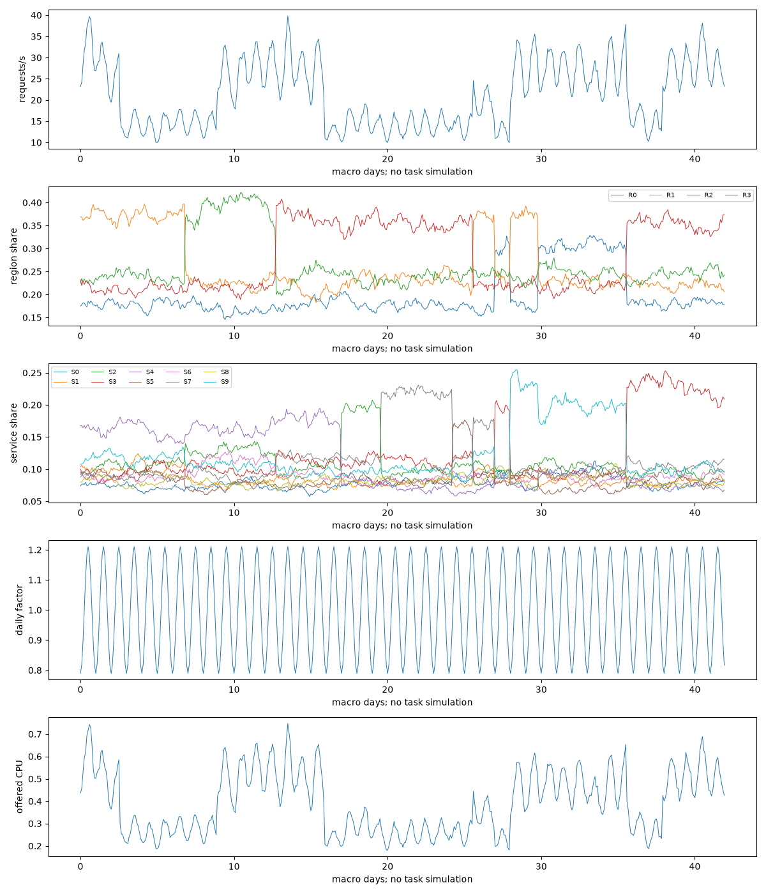

# EXP086 长期需求与部署学习


状态：prepared; smoke and stable-window checks complete。代码：2e23c3786f0fc5d48bd137235777210d2ded4d41。

EXP085最终归档6d11a45、UTF-8校正2e23c37：P1通过、策略一致验证三个候选全拒绝；未运行新最终测试。保留48维资产，不晋级权重。

本轮仅环境与阶段一。D随机初始化，冻结同种子EXP081 GS5040 S；无时机学习。

7200秒宏观一步，24秒微观窗口；不是完整两小时队列等价。8GS训练episode相互独立，168GS评价连续继承队列。

配置/运行值：configs/exp086_long_demand.json、runs/results/EXP086/runtime.json；主协议见PROTOCOL.md。

完成任务E2E按任务加权，period_mean另报；P99包含惩罚请求，原始Reward不改、不平滑。


工程烟测曾遇到沙箱拒绝原子替换已存在best.pt；在本地获准写权限下恢复成功。未修改物理规则或训练参数。EXP085归档中文编码已在2e23c37校正。

片段登记曾误用fixed而物理评价使用holdout；在未运行迁移片段物理收益前，按相同需求可见条件校正该片段。稳定与高强度片段经holdout核验仍满足条件，未更换。原登记与理由保留于window_protocol.initial-fixed-split.json。

`smoke/complete.json`：

```json

{
  "status": "passed",
  "old_mode_exact": true,
  "resume_exact": true,
  "d_updates_per_smoke": 2,
  "s_updates": 0,
  "physical_seconds": 5.338995700003579,
  "physical_gs": 6,
  "requests": 3302,
  "events": 45025,
  "seconds": 54.90525090000301
}

```

`demand_audit.json`：

```json

{
  "status": "complete",
  "summaries": [
    {
      "hours": 72,
      "slots": 4096,
      "mean_rate": 21.538616804800622,
      "rate_sd": 7.074450007777998,
      "autocorrelation1": 0.9512400878581383,
      "residence_hours_quantiles": [
        28.6,
        70.0,
        154.39999999999986
      ],
      "distinct_durations": 55,
      "transitions": 107,
      "daily_mean": 1.0000000000000002,
      "cpu_quantiles": [
        0.16385107284980063,
        0.3956526630159277,
        0.6187015530970359,
        0.781789943985968
      ]
    },
    {
      "hours": 48,
      "slots": 2048,
      "mean_rate": 21.67523924867587,
      "rate_sd": 7.1660769359113115,
      "autocorrelation1": 0.942622710349289,
      "residence_hours_quantiles": [
        20.0,
        46.0,
        96.5
      ],
      "distinct_durations": 40,
      "transitions": 86,
      "daily_mean": 1.0000000000000002,
      "cpu_quantiles": [
        0.1602891951435369,
        0.3924651651710317,
        0.6272226488281596,
        0.7844014795210035
      ]
    },
    {
      "hours": 120,
      "slots": 2048,
      "mean_rate": 21.181392606875434,
      "rate_sd": 7.1076906116269605,
      "autocorrelation1": 0.9517597363523612,
      "residence_hours_quantiles": [
        43.0,
        106.0,
        233.5
      ],
      "distinct_durations": 32,
      "transitions": 36,
      "daily_mean": 1.0000000000000002,
      "cpu_quantiles": [
        0.1817540772936222,
        0.37201307009548906,
        0.6266935544171229,
        0.7930904513112088
      ]
    }
  ],
  "seconds": 2.744342499994673
}

```

生效CPU总量 366.918513 CU/s；成本 {'delay_weight': 10.0, 'reference_rate': 20.0, 'holding_weight': 0.08, 'switch_weight': 0.04, 'removal_ratio': 0.25, 'resource_normalizer': 2.0, 'latency_objective': 'period_mean'}；末端尾段 8.0 s，失败惩罚 10.0 s。

生效参数按基础JSON→EXP043 workload profile→EXP081 B训练配方→EXP086新需求依次导出。拓扑/各节点与阶段参数完整见runtime.json。

源码SHA256：

```json

{
  "scripts/exp086_run.py": "be209144ef7cf7baf800e43dd673a4f0ea5e906d26e6590a783619a2a142cd3b",
  "edge_d/long_demand.py": "28e8ecb1b58e1065ab7ff15f469ef7f21208c29862cfa10207ea33a5e6a313e9",
  "edge_joint/adaptive_training.py": "2094af3d6eb981ebd4870a6a63978d0d5ff502a738af3144c4b38bffdb0f5321",
  "edge_joint/adaptive_runner.py": "27292767dd0d632bff50a32b1c91eb688d2ad033e5f40df64d308147d7ee6a22",
  "edge_joint/adaptive_physics.py": "65e2c933fd32b2ab05dd758386161fdee46aa0f1f7f27ea686112d94a0655fb7",
  "edge_d/placement.py": "91ee46ea2cee00e06cc8eb3e862f417eda6a3536c676aa7b8988cb9f4fd8105d",
  "comparison/monolithic_service/environment.py": "f872fcf4e47ef70e8da65da938533802d58699272a45cafac74c760cc57be724",
  "configs/exp086_long_demand.json": "9b52028450b9362da0aa9ef28fe7c1fbc2a96f52f4eb2cc58938670739a69c67"
}

```




需求主配置均值/驻留/相关性为廉价生成序列结果，不是物理性能；跨轨迹随机相位和中心不等于物理队列预热。

窗口检查 stable：

|窗口/周期槽|Reward|加权E2E|P99|截尾|CPU|墙钟s|

|---|---|---|---|---|---|---|

|24.0|-6.531380|0.633732|1.154894|0|4.306|9.73|

|24.1|-6.547640|0.632429|1.165718|0|3.871|9.05|

|48.0|-6.558876|0.635956|1.152014|0|4.109|18.89|

|48.1|-6.597758|0.637482|1.164221|0|3.977|22.09|

|96.0|-6.506837|0.629218|1.132543|0|4.993|42.96|

|96.1|-6.542504|0.630330|1.148145|0|3.777|43.60|

24s同流REDEPLOY−KEEP：ΔReward=-0.016260，ΔE2E=-0.001304s；共同8s年龄诊断={'0': {'mean_observed_delay': 0.6337324481320311, 'incomplete': 0, 'requests': 4409}, '1': {'mean_observed_delay': 0.6324285629877142, 'incomplete': 0, 'requests': 4409}}。

48s同流REDEPLOY−KEEP：ΔReward=-0.038882，ΔE2E=0.001526s；共同8s年龄诊断={'0': {'mean_observed_delay': 0.6359555639942122, 'incomplete': 0, 'requests': 9012}, '1': {'mean_observed_delay': 0.6374819678117456, 'incomplete': 0, 'requests': 9012}}。

96s同流REDEPLOY−KEEP：ΔReward=-0.035667，ΔE2E=0.001112s；共同8s年龄诊断={'0': {'mean_observed_delay': 0.6292179610007149, 'incomplete': 0, 'requests': 17685}, '1': {'mean_observed_delay': 0.6303301591470426, 'incomplete': 0, 'requests': 17685}}。

窗口收益符号 [-1, -1, -1]；所测片段方向一致，不证明7200s等价。

截止为槽末+8s，长窗口早到请求观察机会更多。age8_diagnostic单独记录共同年龄截止，不能把截尾下降直接解释为改善。

Seed20261113正式训练尚未完成。

Seed20261117正式训练尚未完成。


|种子/模型/周期槽|Reward|任务E2E|periodE2E|P99|严重/截尾/末端|CPU/链路|变更/持有/切换成本|

|---|---|---|---|---|---|---|---|

正式阶段一证据尚未完整，不能给出学习或可靠性通过结论。


复现：`python -m scripts.exp086_run all --workers 2`。中断后同命令恢复。

模型：runs/results/EXP086/seed<seed>/{best,last,resume_latest}.pt。原始训练/fixed/evaluation全部保留。

少量轨迹不代表全部负载；24/48/96秒检查仅覆盖登记片段。新旧环境绝对Reward不可作为算法改进量。
