# EXP087 阶段一复核与时机前置诊断

核心结论：找到了当前D可部分修复的失配，但未完全恢复可靠性。Seed17 last在GS56提前执行其唯一候选，8GS校正折扣净收益增加168.794420；截尾386→40、严重槽6→4、P99 31.155→13.732s。候选显著缓解风险，但仍有失败，不能写成完全修复或T已经能在线识别时机。

当前已观察到净Reward与惩罚时延同时改善的候选点：['20261113.last.change', '20261113.last.stable', '20261113.mature.change', '20261113.mature.stable', '20261117.last.change', '20261117.mature.stable']。

状态：complete；已完成8/最多8点；代码d251713fba806989ea36829851bdcb4959909c9e。

EXP086完整归档394c005；历史自动判定[True,False]原样保留。该判定包含168GS一直KEEP全程零失败的强压力条件，不能代替日尺度保持、固定频率学习和跨场景验证等不同证据。

18条EXP086评价是两个独立外生世界的18个模型/动作臂，不是18个独立场景。Seed17验证best仍为GS0。

R≤−20为严重槽；截尾为到达cohort在原槽末+8s未完成；整段末端残留是最终尾段结束仍在途的请求。边界正常在途不等于失败。前缀terminal缺字段为N/A。

本轮不改环境、成本、D/S或学习算法，不训练T。计数修订不是性能改善。

Seed17首坏附近的已见时间线显示：GS58是load中心从0跳到2，区域/服务热点未变；提供CPU负载从GS57的0.351升至0.678。这是强度变化与日内高峰附近的局部承载风险，不应写成区域/服务迁移。GS56介入是回顾性诊断，不能证明在线策略能预知GS58。

诊断标签是固定KEEP续行下4/8GS有限期差，不是策略一致T标签、最优长期Q或独立泛化试验。

|种子/模型/规则|Reward|任务E2E|periodE2E|P99|严重/截尾/末端|初始化/命令/实际变化|初始化/后续切换成本|

|---|---|---|---|---|---|---|---|

|20261113.train|-8.053186|0.809231|0.788693|2.142407|0/0/0|64/448/448|3.873717/17.301193|

|20261113.fixed|-6.978325|0.687116|0.685584|1.534380|0/0/0|6/42/40|0.325510/0.205605|

|20261113.initial.0|-40.773033|2.011419|1.891654|38.906528|97/9527/541|1/0/0|0.037009/0.000000|

|20261113.initial.1|-10.842496|1.098032|1.075437|2.764411|0/0/0|1/167/163|0.037009/0.704813|

|20261113.initial.12|-12.117389|1.216520|1.163435|6.630888|6/283/0|1/13/13|0.037009/0.137453|

|20261113.last.0|-8.702417|0.878542|0.856499|2.163481|0/0/0|1/0/0|0.068507/0.000000|

|20261113.last.1|-7.803323|0.775067|0.763833|1.609095|0/0/0|1/167/167|0.068507/1.093542|

|20261113.last.12|-7.805137|0.776713|0.764410|1.624344|0/0/0|1/13/13|0.068507/0.230136|

|20261113.mature.0|-7.458476|0.730787|0.720948|1.522039|0/0/0|1/0/0|0.124131/0.000000|

|20261113.mature.1|-7.365225|0.718109|0.709773|1.303708|0/0/0|1/167/166|0.124131/1.791572|

|20261113.mature.12|-7.378358|0.720881|0.711949|1.327700|0/0/0|1/13/13|0.124131/0.285069|

|20261117.train|-8.627259|0.882161|0.848550|2.497806|0/0/0|64/448/448|3.428029/15.679197|

|20261117.fixed|-8.571057|0.920416|0.845997|2.804361|0/0/0|6/42/42|0.285314/0.243682|

|20261117.initial.0|-23.383578|1.465243|1.272439|36.609194|35/4437/0|1/0/0|0.041160/0.000000|

|20261117.initial.1|-8.079919|0.838001|0.798578|2.272099|0/0/0|1/167/154|0.041160/0.504772|

|20261117.initial.12|-10.865027|1.094768|0.948887|19.886010|9/753/0|1/13/13|0.041160/0.109925|

|20261117.last.0|-9.897352|1.059331|0.914551|11.832971|9/392/0|1/0/0|0.039405/0.000000|

|20261117.last.1|-7.381538|0.756197|0.728541|1.755725|0/0/0|1/167/163|0.039405/0.835870|

|20261117.last.12|-7.832120|0.843267|0.770327|3.958987|3/32/0|1/13/13|0.039405/0.125270|

|20261117.mature.0|-6.182803|0.607834|0.592937|1.060111|0/0/0|1/0/0|0.126342/0.000000|

|20261117.mature.1|-6.174672|0.605286|0.590644|1.047928|0/0/0|1/167/167|0.126342/1.489156|

|20261117.mature.12|-6.176694|0.606438|0.591537|1.061193|0/0/0|1/13/13|0.126342/0.256632|

计数与缺字段核对：{'train_old_changes': 511, 'train_corrected_changes': 448, 'bootstrap': 64, 'continuous_unchanged': True, 'prefix_terminal': None, 'prefix_boundary_inflight': 19}

20261113 last KEEP 24h：E2E=0.704744，截尾=0，严重=0，前缀terminal=N/A，边界在途=19。

20261113 last KEEP 48h：E2E=0.711879，截尾=0，严重=0，前缀terminal=N/A，边界在途=14。

20261117 last KEEP 24h：E2E=0.700522，截尾=0，严重=0，前缀terminal=N/A，边界在途=8。

20261117 last KEEP 48h：E2E=0.728360，截尾=0，严重=0，前缀terminal=N/A，边界在途=14。

Seed17/last/周期0槽：{'first_severe': 58, 'first_censored': 58, 'peak_work': 61}。

|GS|中心变化|负载|CPU工作|Reward|E2E|截尾|实际变化|

|---|---|---|---|---|---|---|---|

|55|[]|0.265|8.686|-6.8210|0.6742|0|False|

|56|[]|0.295|23.604|-7.1573|0.7078|0|False|

|57|[]|0.351|33.620|-8.5565|0.8478|0|False|

|58|['load']|0.678|292.048|-38.6773|3.4506|24|False|

|59|[]|0.662|274.146|-58.1007|4.2181|76|False|

|60|[]|0.663|295.743|-58.1463|3.6604|94|False|

|61|[]|0.540|316.677|-72.2782|2.6215|127|False|

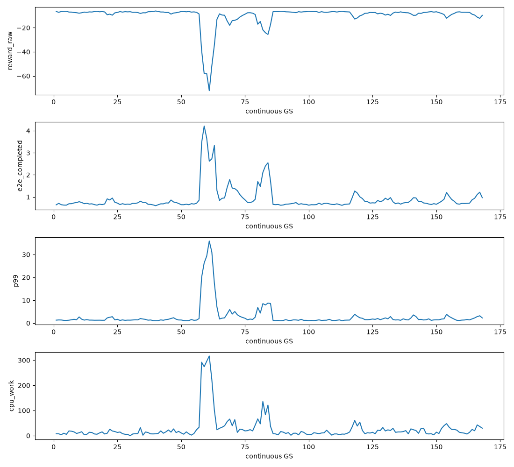

Seed17/last/周期12槽：{'first_severe': 58, 'first_censored': 58, 'peak_work': 58}。

|GS|中心变化|负载|CPU工作|Reward|E2E|截尾|实际变化|

|---|---|---|---|---|---|---|---|

|55|[]|0.265|7.618|-6.8756|0.6790|0|False|

|56|[]|0.295|29.708|-7.3409|0.7255|0|False|

|57|[]|0.351|24.946|-8.1948|0.8109|0|False|

|58|['load']|0.678|199.014|-29.2670|2.7437|10|False|

|59|[]|0.662|170.636|-31.4067|3.0448|5|False|

|60|[]|0.663|161.920|-31.7176|2.8150|17|False|

|61|[]|0.540|35.048|-10.3387|1.0221|0|True|

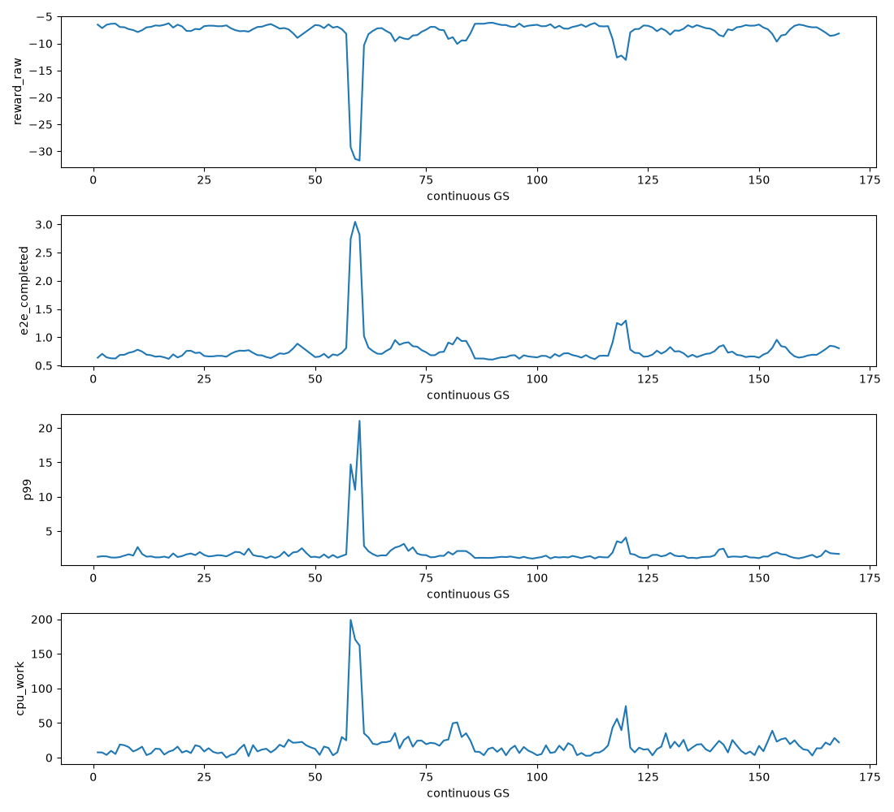

Seed17/last/周期1槽：{'first_severe': None, 'first_censored': None, 'peak_work': 58}。

|GS|中心变化|负载|CPU工作|Reward|E2E|截尾|实际变化|

|---|---|---|---|---|---|---|---|

|55|[]|0.265|9.639|-6.8643|0.6768|0|True|

|56|[]|0.295|25.437|-7.2321|0.7130|0|True|

|57|[]|0.351|17.122|-7.7436|0.7644|0|True|

|58|['load']|0.678|65.298|-11.5992|1.1476|0|True|

|59|[]|0.662|46.138|-9.7509|0.9641|0|True|

|60|[]|0.663|36.582|-10.5609|1.0448|0|True|

|61|[]|0.540|38.888|-8.7550|0.8650|0|True|

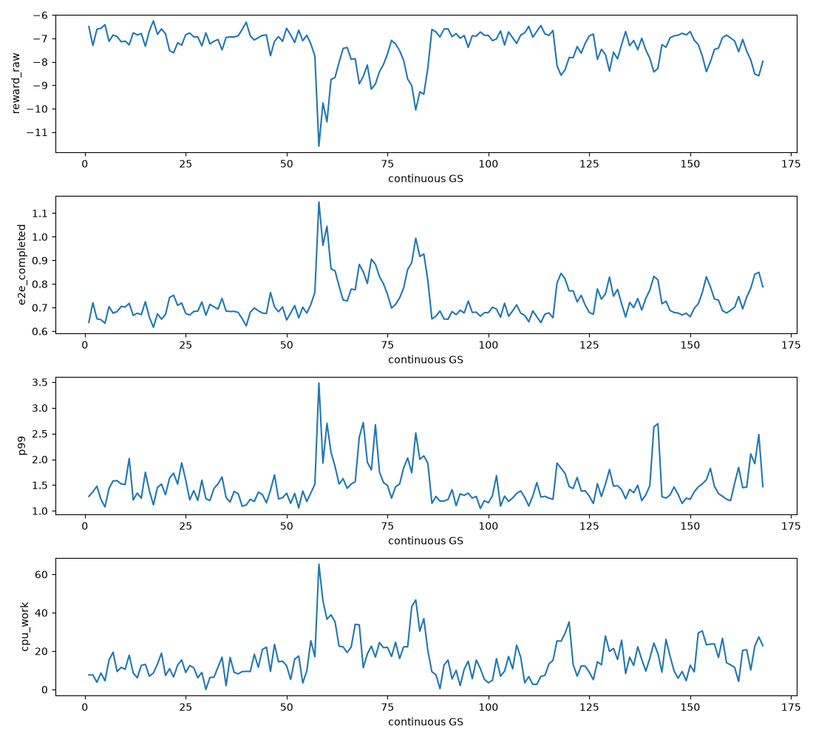

Seed17/mature/周期0槽：{'first_severe': None, 'first_censored': None, 'peak_work': 84}。

|GS|中心变化|负载|CPU工作|Reward|E2E|截尾|实际变化|

|---|---|---|---|---|---|---|---|

|55|[]|0.265|9.712|-5.9580|0.5705|0|False|

|56|[]|0.295|24.909|-6.0236|0.5771|0|False|

|57|[]|0.351|9.302|-6.2179|0.5965|0|False|

|58|['load']|0.678|24.838|-8.0328|0.7780|0|False|

|59|[]|0.662|33.880|-7.5761|0.7323|0|False|

|60|[]|0.663|26.779|-7.5985|0.7346|0|False|

|61|[]|0.540|35.767|-6.7893|0.6537|0|False|

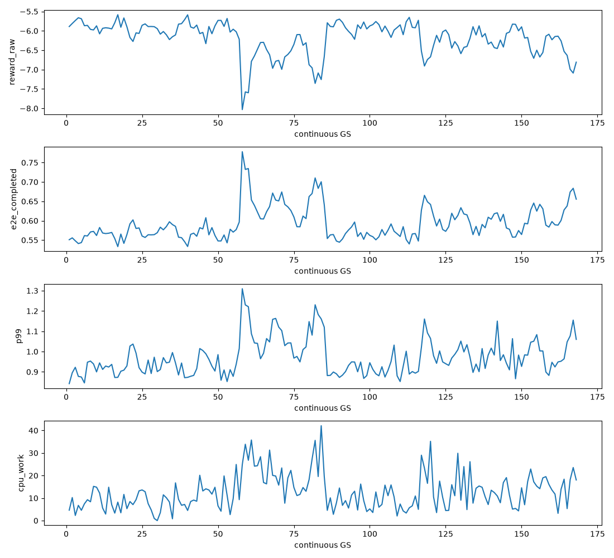

Seed17/mature/周期12槽：{'first_severe': None, 'first_censored': None, 'peak_work': 61}。

|GS|中心变化|负载|CPU工作|Reward|E2E|截尾|实际变化|

|---|---|---|---|---|---|---|---|

|55|[]|0.265|7.316|-5.9370|0.5677|0|False|

|56|[]|0.295|26.559|-6.0329|0.5773|0|False|

|57|[]|0.351|8.609|-6.2591|0.5999|0|False|

|58|['load']|0.678|20.263|-8.1075|0.7848|0|False|

|59|[]|0.662|37.739|-7.6097|0.7350|0|False|

|60|[]|0.663|21.293|-7.5912|0.7331|0|False|

|61|[]|0.540|41.339|-6.6917|0.6414|0|True|

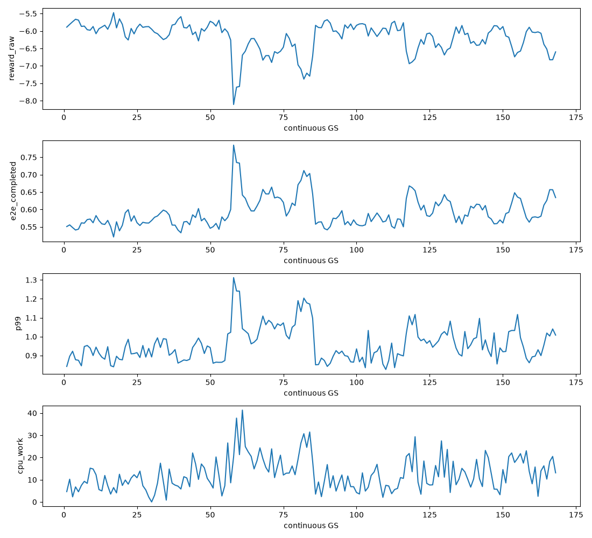

Seed17/mature/周期1槽：{'first_severe': None, 'first_censored': None, 'peak_work': 61}。

|GS|中心变化|负载|CPU工作|Reward|E2E|截尾|实际变化|

|---|---|---|---|---|---|---|---|

|55|[]|0.265|6.862|-5.9705|0.5703|0|True|

|56|[]|0.295|20.159|-5.9729|0.5713|0|True|

|57|[]|0.351|9.314|-6.2141|0.5955|0|True|

|58|['load']|0.678|23.866|-8.1893|0.7912|0|True|

|59|[]|0.662|34.662|-7.4450|0.7169|0|True|

|60|[]|0.663|18.555|-7.6325|0.7355|0|True|

|61|[]|0.540|36.889|-6.6992|0.6434|0|True|

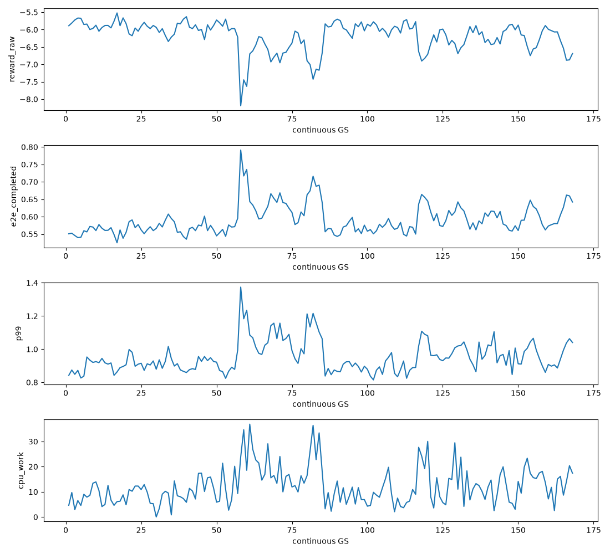

## 20261113.last.change / GS32

选择依据：First observed regional/service center change at GS>=12; no branch reward selection；真正无变化=False；分叉墙钟14.01s。

|长度|原始R-K|旧cohort成本差|校正R-K|时延成本差|持有差|切换差|K/R E2E|K/R P99|K/R截尾|

|---|---|---|---|---|---|---|---|---|---|

|4|2.791923|0.001806|2.790116|-2.914106|0.087502|0.036487|0.831652/0.757424|1.721422/1.372534|0/0|

|8|5.141907|0.001806|5.140100|-5.348144|0.171557|0.036487|0.817997/0.748430|1.654627/1.363296|0/0|

在该有限窗口内候选有可执行的净改善；是否修复严重失配还须结合下面截尾和积压，不推广为最优时机。

8GS末端K/R残留：0/0；CPU最大期末工作8.854/6.192；旧/新总副本103/112。

增删资源RAM/SSD：[115.33144368490692, 716.0796156251834]/[96.76800357930428, 287.13673399058666]；实际切换成本0.036487。

臂0：完成4722/4722，惩罚E2E=0.817997，严重槽=0；实际8GS尾段末资源工作量：CPU=0.000000CU，有线=0.000000Mbit。

臂1：完成4722/4722，惩罚E2E=0.748430，严重槽=0；实际8GS尾段末资源工作量：CPU=0.000000CU，有线=0.000000Mbit。

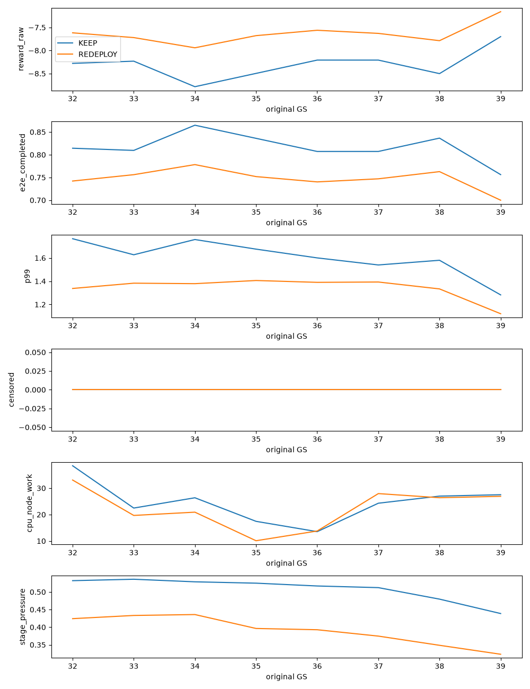

## 20261113.last.stable / GS4

选择依据：First observed four-slot structurally stable prefix in GS4..12；真正无变化=False；分叉墙钟9.26s。

|长度|原始R-K|旧cohort成本差|校正R-K|时延成本差|持有差|切换差|K/R E2E|K/R P99|K/R截尾|

|---|---|---|---|---|---|---|---|---|---|

|4|0.025009|0.002477|0.022532|-0.078735|0.044622|0.011581|0.679138/0.677108|1.293078/1.295273|0/0|

|8|0.044602|0.002477|0.042125|-0.141192|0.087486|0.011581|0.696994/0.695287|1.409596/1.420611|0/0|

在该有限窗口内候选有可执行的净改善；是否修复严重失配还须结合下面截尾和积压，不推广为最优时机。

8GS末端K/R残留：0/0；CPU最大期末工作9.231/9.231；旧/新总副本103/110。

增删资源RAM/SSD：[42.87651914884847, 205.25153850252747]/[17.52402245135368, 115.22529756391]；实际切换成本0.011581。

臂0：完成3449/3449，惩罚E2E=0.696994，严重槽=0；实际8GS尾段末资源工作量：CPU=0.000000CU，有线=0.000000Mbit。

臂1：完成3449/3449，惩罚E2E=0.695287，严重槽=0；实际8GS尾段末资源工作量：CPU=0.000000CU，有线=0.000000Mbit。

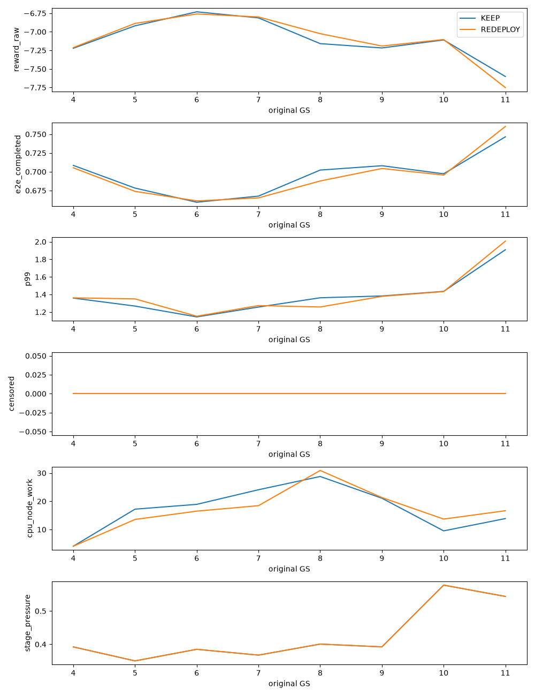

## 20261113.mature.change / GS32

选择依据：First observed regional/service center change at GS>=12; no branch reward selection；真正无变化=False；分叉墙钟14.10s。

|长度|原始R-K|旧cohort成本差|校正R-K|时延成本差|持有差|切换差|K/R E2E|K/R P99|K/R截尾|

|---|---|---|---|---|---|---|---|---|---|

|4|0.157418|0.000324|0.157094|-0.236083|0.038072|0.040917|0.727499/0.721509|1.493665/1.285608|0/0|

|8|0.145546|0.000324|0.145221|-0.260782|0.074643|0.040917|0.717782/0.714476|1.439385/1.258232|0/0|

在该有限窗口内候选有可执行的净改善；是否修复严重失配还须结合下面截尾和积压，不推广为最优时机。

8GS末端K/R残留：0/0；CPU最大期末工作5.665/6.463；旧/新总副本181/190。

增删资源RAM/SSD：[137.73676801080182, 678.6763812987667]/[115.27602181945214, 587.722898240859]；实际切换成本0.040917。

臂0：完成4722/4722，惩罚E2E=0.717782，严重槽=0；实际8GS尾段末资源工作量：CPU=0.000000CU，有线=0.000000Mbit。

臂1：完成4722/4722，惩罚E2E=0.714476，严重槽=0；实际8GS尾段末资源工作量：CPU=0.000000CU，有线=0.000000Mbit。

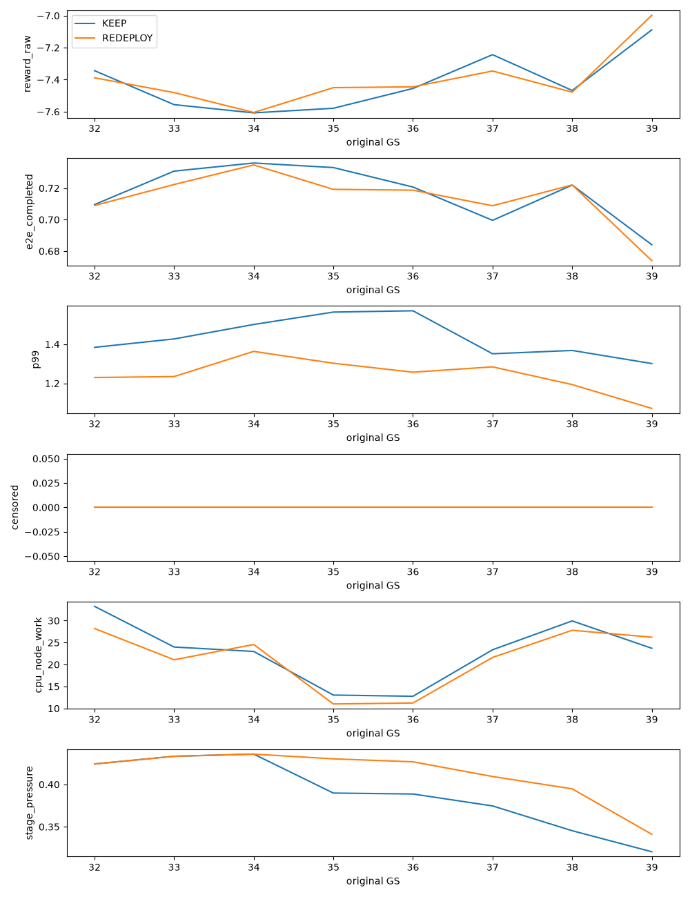

## 20261113.mature.stable / GS4

选择依据：First observed four-slot structurally stable prefix in GS4..12；真正无变化=False；分叉墙钟9.81s。

|长度|原始R-K|旧cohort成本差|校正R-K|时延成本差|持有差|切换差|K/R E2E|K/R P99|K/R截尾|

|---|---|---|---|---|---|---|---|---|---|

|4|0.009556|0.002513|0.007043|-0.027470|0.005730|0.014698|0.622306/0.621876|1.283896/1.255038|0/0|

|8|0.106531|0.002513|0.104018|-0.129950|0.011234|0.014698|0.636993/0.635377|1.355012/1.339996|0/0|

在该有限窗口内候选有可执行的净改善；是否修复严重失配还须结合下面截尾和积压，不推广为最优时机。

8GS末端K/R残留：0/0；CPU最大期末工作7.102/7.102；旧/新总副本181/185。

增删资源RAM/SSD：[57.145741933110486, 143.3666509334448]/[40.50940210814762, 195.54053928815426]；实际切换成本0.014698。

臂0：完成3449/3449，惩罚E2E=0.636993，严重槽=0；实际8GS尾段末资源工作量：CPU=0.000000CU，有线=0.000000Mbit。

臂1：完成3449/3449，惩罚E2E=0.635377，严重槽=0；实际8GS尾段末资源工作量：CPU=0.000000CU，有线=0.000000Mbit。

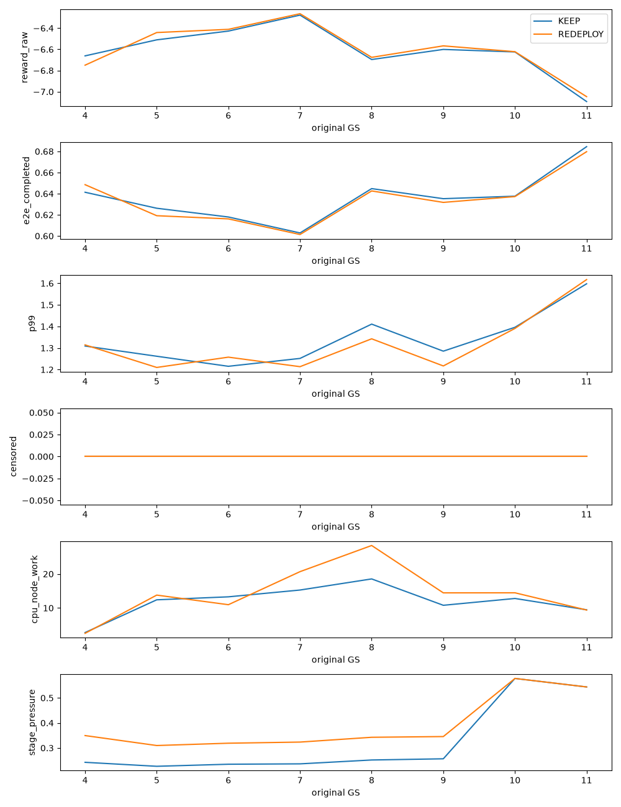

## 20261117.last.change / GS56

选择依据：Two GS before historically first severe/censored GS58; retrospective mechanism diagnosis；真正无变化=False；分叉墙钟17.78s。

|长度|原始R-K|旧cohort成本差|校正R-K|时延成本差|持有差|切换差|K/R E2E|K/R P99|K/R截尾|

|---|---|---|---|---|---|---|---|---|---|

|4|44.373666|0.002123|44.371543|-44.444021|0.055730|0.016749|2.807568/1.956501|23.983621/8.308728|100/6|

|8|168.796543|0.002123|168.794420|-168.920432|0.109264|0.016749|2.972531/1.995638|31.154625/13.732343|386/40|

在该有限窗口内候选有可执行的净改善；是否修复严重失配还须结合下面截尾和积压，不推广为最优时机。

8GS末端K/R残留：0/0；CPU最大期末工作274.137/91.769；旧/新总副本58/63。

增删资源RAM/SSD：[50.9838131539633, 366.40828479214395]/[33.408321508099384, 177.77674612318765]；实际切换成本0.016749。

臂0：完成5042/5428，惩罚E2E=4.535667，严重槽=6；实际8GS尾段末资源工作量：CPU=0.000000CU，有线=0.000000Mbit。

臂1：完成5388/5428，惩罚E2E=2.131802，严重槽=4；实际8GS尾段末资源工作量：CPU=0.000000CU，有线=0.000000Mbit。

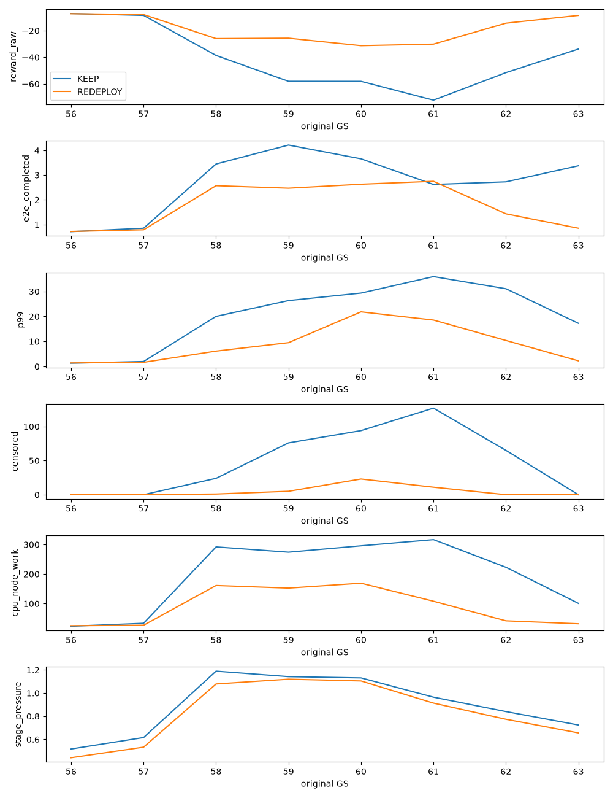

## 20261117.last.stable / GS4

选择依据：First observed four-slot structurally stable prefix in GS4..12；真正无变化=False；分叉墙钟7.48s。

|长度|原始R-K|旧cohort成本差|校正R-K|时延成本差|持有差|切换差|K/R E2E|K/R P99|K/R截尾|

|---|---|---|---|---|---|---|---|---|---|

|4|-0.507330|0.000000|-0.507330|0.531382|-0.027759|0.003706|0.661986/0.675128|1.346734/1.370922|0/0|

|8|-0.986808|0.000000|-0.986808|1.037526|-0.054424|0.003706|0.713577/0.727613|1.662067/1.867106|0/0|

该候选在所测窗口未表现出净修复收益；需区分候选质量、遗留积压及观察期限，不能据此判定D整体无能力。

8GS末端K/R残留：0/0；CPU最大期末工作6.173/6.416；旧/新总副本58/53。

增删资源RAM/SSD：[12.040126749017698, 16.1143194469358]/[25.090123692515995, 116.81292288498439]；实际切换成本0.003706。

臂0：完成2541/2541，惩罚E2E=0.713577，严重槽=0；实际8GS尾段末资源工作量：CPU=0.000000CU，有线=0.000000Mbit。

臂1：完成2541/2541，惩罚E2E=0.727613，严重槽=0；实际8GS尾段末资源工作量：CPU=0.000000CU，有线=0.000000Mbit。

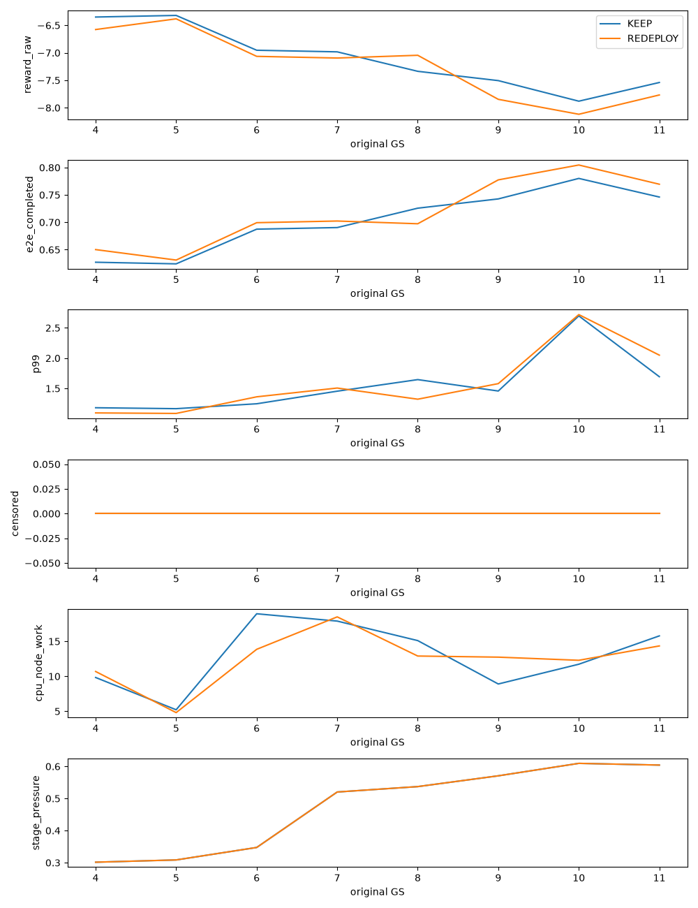

## 20261117.mature.change / GS27

选择依据：First observed regional/service center change at GS>=12; no branch reward selection；真正无变化=False；分叉墙钟8.07s。

|长度|原始R-K|旧cohort成本差|校正R-K|时延成本差|持有差|切换差|K/R E2E|K/R P99|K/R截尾|

|---|---|---|---|---|---|---|---|---|---|

|4|-0.115768|-0.013404|-0.102364|0.045738|0.020135|0.036491|0.564943/0.566462|0.928357/0.939335|0/0|

|8|-0.138130|-0.013404|-0.124727|0.048759|0.039477|0.036491|0.576958/0.577972|0.944663/0.949241|0/0|

该候选在所测窗口未表现出净修复收益；需区分候选质量、遗留积压及观察期限，不能据此判定D整体无能力。

8GS末端K/R残留：0/0；CPU最大期末工作3.162/3.162；旧/新总副本184/187。

增删资源RAM/SSD：[118.00529702360015, 601.6376584121392]/[106.23458021358624, 540.6891686673193]；实际切换成本0.036491。

臂0：完成2656/2656，惩罚E2E=0.576958，严重槽=0；实际8GS尾段末资源工作量：CPU=0.000000CU，有线=0.000000Mbit。

臂1：完成2656/2656，惩罚E2E=0.577972，严重槽=0；实际8GS尾段末资源工作量：CPU=0.000000CU，有线=0.000000Mbit。

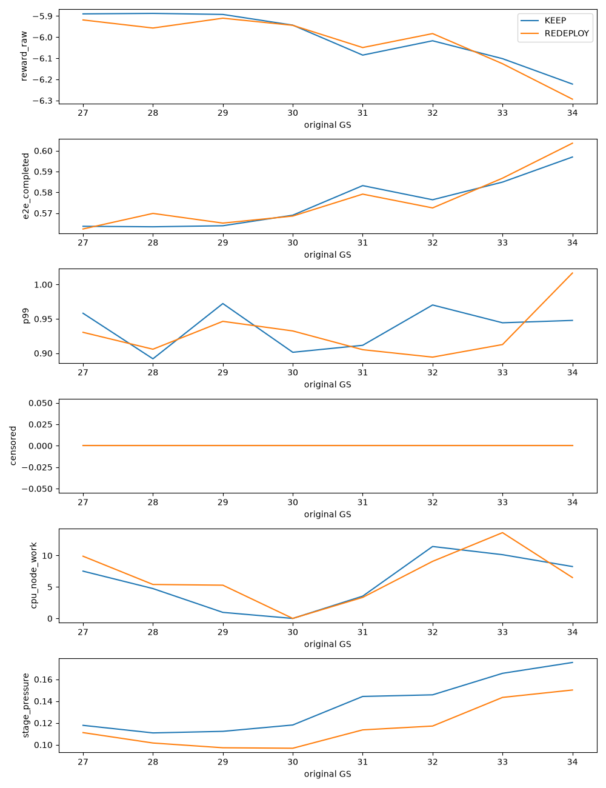

## 20261117.mature.stable / GS4

选择依据：First observed four-slot structurally stable prefix in GS4..12；真正无变化=False；分叉墙钟7.49s。

|长度|原始R-K|旧cohort成本差|校正R-K|时延成本差|持有差|切换差|K/R E2E|K/R P99|K/R截尾|

|---|---|---|---|---|---|---|---|---|---|

|4|0.056656|-0.002788|0.059444|-0.095742|0.015911|0.020387|0.553048/0.550420|0.917166/0.898048|0/0|

|8|0.164852|-0.002788|0.167641|-0.219223|0.031195|0.020387|0.564066/0.561004|0.935805/0.926211|0/0|

在该有限窗口内候选有可执行的净改善；是否修复严重失配还须结合下面截尾和积压，不推广为最优时机。

8GS末端K/R残留：0/0；CPU最大期末工作3.491/3.491；旧/新总副本184/188。

增删资源RAM/SSD：[67.77867961378779, 327.78178945597443]/[54.6577048310511, 299.0860310011349]；实际切换成本0.020387。

臂0：完成2541/2541，惩罚E2E=0.564066，严重槽=0；实际8GS尾段末资源工作量：CPU=0.000000CU，有线=0.000000Mbit。

臂1：完成2541/2541，惩罚E2E=0.561004，严重槽=0；实际8GS尾段末资源工作量：CPU=0.000000CU，有线=0.000000Mbit。

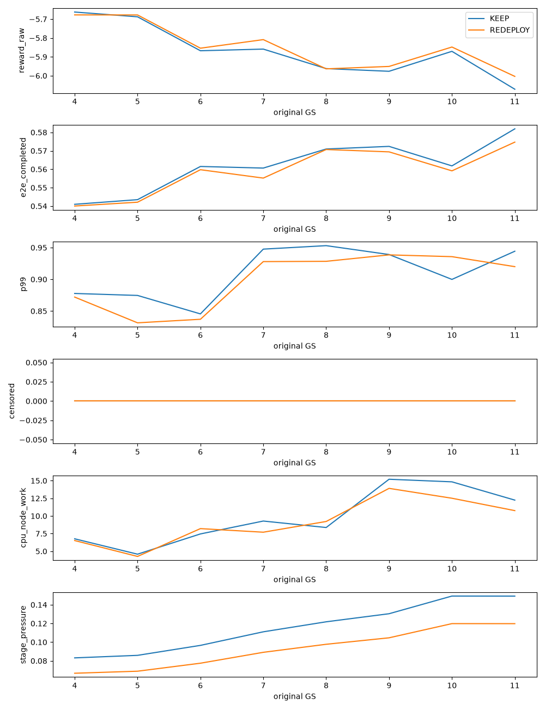

## 下一阶段入口

已成立：两种子固定2h同世界last优于随机初始、已测起点24h/48h保持无严重或截尾、成熟模型迁移可靠。未成立：Seed17固定验证稳定改善、任意起点长保持、长期统计非劣。

建议将EXP081 mature两配对作为同一版本的时机开发候选基线；EXP086 last两配对单独保留为部署学习研究组，不跨种子挑选拼接。成熟KEEP和24h已是强参照，T的额外收益空间仍需证明。

后续只开放T；连续轨迹短批次继承物理状态并正确处理截断；不得读取剩余驻留。需固定2h/24h/KEEP参照、全新最终流、事前非劣界限以及与实际续策一致且绑定D/S版本的信用。不直接使用本轮固定KEEP标签作为最终T价值目标。

命令：`python -m scripts.exp087_run all --workers 2`；所有身份/registry/紧凑时间线/pairs/replays保存在runs/results/EXP087。完整EXP086资产哈希在runs/results/EXP086/archive/manifest.json。阶段一原始训练及验证图仍在research/EXP086/AI_RESEARCH_REVIEW.md，未以3点验证曲线代替原始512GS。

## 机制判断与局限

Seed13 last GS32候选降低E2E约69.6ms、8GS净回报差+5.1401，支持变化后的旧布局可被当前D改善。Seed17 last GS56候选降低E2E约976.9ms，但仍40截尾/4严重槽，属于部分修复，尚不能区分其承载余量不足与未来负载进一步变化下再次调整的必要性。没有追加分支去强行区分。

Seed17 mature GS27虽发生结构变化，KEEP仍略优且两臂均无失败；结构变化不是重部署答案。Seed17 last稳定GS4换候选反而增加约14.0ms E2E，支持拒绝较差新布局。其余稳定点的收益很小，不据这些点证明复杂T优于成熟模型固定周期。

时延成本下降但不足以抵消成本的KEEP点：[]。本轮没有补齐此类型案例；不能声称真实切换成本经济权衡已经广泛得到验证。4/8GS收益方向反转点：[]；范围有限，不推出更长周期或自适应续策同方向。

固定24h在GS49调整后GS58开始失效、下一次GS61调整后改善，支持周期相位可能错过变化；但这不是同状态GS58动作因果试验。GS56分叉是相同旧状态的真实反事实，且未把未来负载输给D；选点本身使用已见失败，因此不能证明未来T可以预判。

两个分支最终尾段残留为零不抵消早期严重槽与截尾。旧队列随瞬时切换继续执行，没有迁移或清空；上一cohort校正幅度已逐点列出，远小于Seed17改善，主差异来自随后请求而非边界漏账。

下一步若只补D：优先核验Seed17 last在持续高强度中心的单次布局承载及固定验证跨场景稳定性，不机械加GS。本轮未执行该补充。若开展T开发，优先整体冻结EXP081成熟配对、保留24h与KEEP强对照；这是开发入口建议，不是T晋级结论。

实际工作量：8对=16条8GS分支，共128分支GS；确定性回放151GS；分支事件814052、回放事件772152。累计分支墙钟88.01s，回放墙钟83.00s（并行工作之和，不等于经过时间）；首对回放2.53s+分支9.26s，余下任务主程序经过89.91s。
