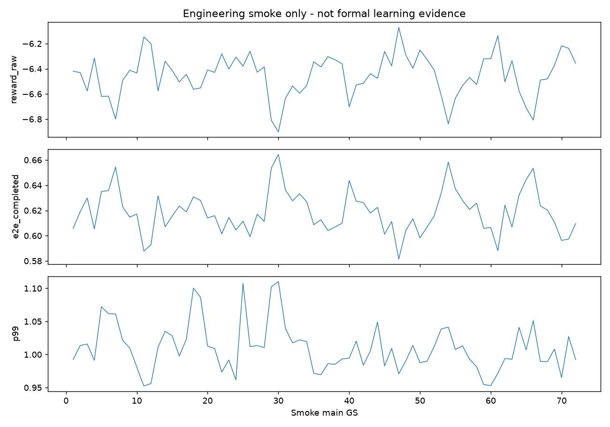

# EXP088 时机 DDQN 研究审阅

**T真实学习：** 尚未完成正式训练和验证，不能认定已学会。

**相对2h基本目标：** 尚无最终独立评价结论。

**相对24h/KEEP：** 尚未证明比性能可行的24h/KEEP有额外价值。

状态：training and fixed validation running。已完成正式训练 0/2。更新于北京时间 2026-11-28T22:21:35+08:00。

结论：T 是否产生真实物理学习改善、是否达到相对2h基本目标、是否胜过可行24h/KEEP，必须分别判定。未完成/未打开的最终评价不称失败或成功。

最终流状态：opened=False，training/validation pending。

沿用EXP086环境、EXP081成熟D/S整体配对；EXP086 last不混入。D/S更新0。原Reward和因果r_train分别记录。单步反事实仅为离策略经验，不能在线选动作。历史EXP087八点不是新标签。

主训练24独立世界×168GS，世界内连续队列，世界间重置；额外GS169只结算原日志。任务加权完成时延是验收口径，原Reward仍按period_mean。1%为工程开发约定，不是统计非劣证明。

完整参数、53维单位、随机流、选模顺序见PROTOCOL.md和runs/results/EXP088/protocol.json。完整本地物理记录/模型的路径、大小、SHA256见manifest.json；compact保存可重画逐槽原始曲线。

实际CPU总量366.918512674857 CU/s；原cost={'delay_weight': 10.0, 'reference_rate': 20.0, 'holding_weight': 0.08, 'switch_weight': 0.04, 'removal_ratio': 0.25, 'resource_normalizer': 2.0, 'latency_objective': 'period_mean'}；tail=8.0s、failure_penalty=10.0s。T参数2307。模型last投影只含S online，冻结target按EXP086评价契约复制online；target不参与物理调度，也不更新。

## 工程烟测

通过=True；72主GS、4真实T更新、2对单步物理经验。耗时61.162s，首对1.885s。完成信用恒等式 -24.787507113067040 vs -24.787507113067043、原整段/分块同流同账本、D/S不变、恢复后下一更新精确一致。烟测不参与正式收益判断。

可靠性、资源费用与保持行为不能由平均Reward抵消。全KEEP/全R要按物理表现比较；固定24h/KEEP若更便宜且性能可行，复杂T额外价值未证。未通过不自动扩训、改环境或开放联合学习。

保持间隔、右删失、初始/后续切换费、持有费、CPU/链路峰值、实际请求/事件和逐世界墙钟在每个evaluation/world的metrics中独立保存；不能把世界边界拼成保持周期。

复现：`python -m scripts.exp088_run all --workers 2`；只重绘：`python -m scripts.exp088_run report`。

报告生成时源码：{'commit': '358d55bf3d2835978d3675aee5587c76a0d6558c', 'dirty': True, 'tracked_dirty': True, 'python': '3.11.7', 'os': 'Windows-10-10.0.26200-SP0', 'torch': '2.11.0+cpu', 'numpy': '2.4.6'}。模型和实验自身记录其执行版本；后续仅报告修改不等于物理重跑。
